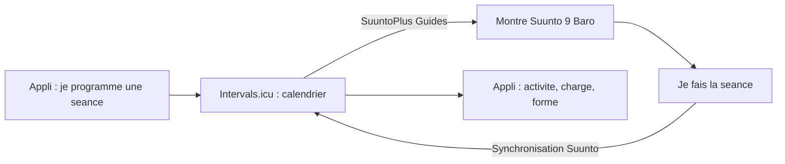
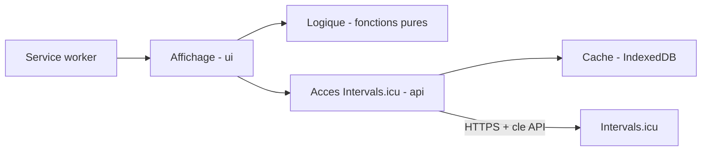

# CLAUDE.md : Application d'entraînement triathlon connectée à Intervals.icu

> **Ce fichier est la référence du projet (CDC v2.0).** Il contient le cahier des charges, le découpage en lots et les règles de développement.
> Toute modification du périmètre est notée dans le **journal des décisions** (section 10).
> La v2.0 remplace la v1.0 (application 100 % locale à saisie manuelle), abandonnée le 22/11/2026 (D-01).

---

## 0. Règles pour l'assistant (à lire en premier)

### 0.1 Méthode
- **Langue** : réponses, commentaires de code et interface en **français**.
- **Code** : modifier **directement les fichiers du projet**. Ne pas recopier les fichiers dans la conversation.
- **Périmètre** : ne coder **que le lot en cours** (section 9). Ne rien ajouter qui ne soit pas dans ce document. Une idée hors périmètre se propose à la fin de la tâche, elle ne se code pas.
- **Traçabilité** : chaque fonction codée renvoie à son identifiant (F-xx, ENF-xx, C-xx) dans un commentaire.
- **Liberté technique** : à l'intérieur de ce cadre, l'assistant choisit librement l'organisation du code, les noms, les détails de design et les tests. Il ne demande pas la permission pour ces choix.
- **Blocage** : en cas de vrai doute fonctionnel (pas technique), s'arrêter et poser la question plutôt que deviner.

### 0.2 Code
- **Simplicité** : HTML/CSS/JS **sans framework**, sans étape de compilation, modules JS natifs (`import` / `export`).
- **Couches** (section 5.3) : l'affichage (`ui/`) ne calcule rien ; la logique (`logique/`) est faite de **fonctions pures** ; seule la couche `api/` appelle Intervals.icu ; seule la couche `cache/` accède à IndexedDB.
- **Imports** : avant de modifier un fichier, vérifier les noms réellement exportés par les modules qu'il importe. Une seule erreur d'import rend toute l'application blanche.
- **Encodage** : fichiers en **UTF-8**. Pas de caractères typographiques spéciaux (tirets longs, guillemets courbes) dans le code et le HTML.
- **API Intervals.icu** : avant d'utiliser un endpoint ou un nom de champ, le **vérifier dans la documentation officielle** (section 5.6). Ne jamais deviner un nom de champ.

### 0.3 Sécurité
- **Clé API** : jamais dans le code, jamais dans git, jamais dans les journaux de la console, jamais dans un export. Elle est saisie par l'utilisateur dans l'écran Réglages et stockée uniquement sur l'appareil.
- **Aucun autre service tiers** que ceux autorisés en ENF-12 (pas de traceur, police externe, CDN, statistiques).
- **Aucun secret dans le dépôt** (destiné à être public) : ni clé, ni jeton, ni mot de passe, même dans les tests, les commentaires ou les exemples. Le `.gitignore` exclut `.env*`, `.claude/settings.local.json`, les dossiers de travail, les sauvegardes, les exports et les fichiers d'activité (`.fit`, `.gpx`, `.tcx`).
- **Données insérées dans le HTML** : toute valeur venant d'Intervals.icu ou de l'adresse (`#/...?param=`) passe par `echapperHtml` (ou `encodeURIComponent` dans une URL, ou une fonction de `logique/format.js` qui renvoie un texte sûr) avant un `innerHTML`. Un paramètre d'adresse est vérifié (format attendu) avant usage. Jamais d'`eval`, de `new Function`, de `setTimeout` avec une chaîne ni d'attribut `on...`.
- **Liens externes** : `https` uniquement, jamais construits à partir des données ; `rel="noopener noreferrer"` pour un nouvel onglet.
- **CSP stricte** dans `index.html` : pas de `'unsafe-inline'` ni de `'unsafe-eval'`, `connect-src` et `img-src` limités aux domaines d'ENF-12, tout le reste en `'self'`. Une balise meta ne peut pas porter `frame-ancestors` (GitHub Pages ne permet pas d'en-têtes) : l'appli refuse elle-même de s'ouvrir dans une iframe.
- **Tests** : données inventées uniquement (pas de vraies activités, noms, lieux ni traces GPS) ; réponses d'Intervals.icu simulées.
- **Actions destructrices** : toute suppression ou tout remplacement de séances dans Intervals.icu demande une confirmation ; une suppression groupée ne vise que les séances créées par l'appli (étiquette `external_id`).
- Ces règles sont vérifiées automatiquement par `tests/securite.test.js` et à chaque recette.

### 0.4 Fin de chaque tâche
1. Incrémenter `VERSION` dans `sw.js` et `VERSION_APP` côté JS.
2. Lancer `node --test` : tout doit passer.
3. Vérifier qu'il n'y a aucune erreur d'import.
4. Faire un commit git avec un message en français qui cite les identifiants (F-xx, C-xx).
5. Résumer en quelques lignes : ce qui est fait, ce que je dois tester moi-même.

### 0.5 Environnement de développement
- Poste Windows, dossier : `C:\Users\quent\Desktop\Code\appli_triathlon`
- **Ne jamais ouvrir `index.html` en double-cliquant** (`file://` bloque les modules JS : page blanche).
- Serveur local, lancé **depuis le dossier du projet** et limité au PC :
  ```powershell
  python -m http.server 8000 --bind 127.0.0.1
  ```
  puis ouvrir **http://localhost:8000**.
- Pendant le développement : F12, **Application, Service workers**, cocher « Update on reload », puis recharger avec **Ctrl+F5**.
- En cas de page blanche : F12, **Console**, lire l'erreur rouge (fichier + ligne).
- Tests automatiques : `node --test`

---

## 1. Objectif du projet

### 1.1 Contexte
Je prépare des triathlons en alternance, avec un emploi du temps variable et peu de temps d'entraînement. J'utilise une **montre Suunto 9 Baro**. Mes activités sont synchronisées vers **Intervals.icu**, qui calcule ma charge et ma forme.

### 1.2 Problème
- L'appli Suunto affiche bien mes activités mais ne permet pas de **planifier** sérieusement.
- Intervals.icu est très complet mais son site est **dense et peu pratique sur téléphone**.
- Je veux **une seule appli mobile, claire et agréable**, pour tout voir et tout programmer.

### 1.3 Objectif général
> **Créer une application mobile soignée, inspirée de l'appli Suunto, qui utilise Intervals.icu comme source de données pour suivre, analyser et programmer mes entraînements de triathlon.**

### 1.4 Objectifs spécifiques

| N° | Objectif | Résultat attendu |
|---|---|---|
| O1 | **Voir** | En ouvrant l'appli, je vois ma dernière activité, ma séance du jour et ma forme |
| O2 | **Suivre** | Je parcours mes activités réalisées et leurs détails |
| O3 | **Planifier** | Je programme une séance structurée en moins d'une minute, et elle arrive sur ma montre |
| O4 | **Comprendre** | Je vois ma charge, ma forme et l'écart entre le prévu et le réalisé |

### 1.5 La boucle complète


### 1.6 Utilisateur cible
**Un seul utilisateur : moi.** Multi-utilisateur et mode coach : hors périmètre.

### 1.7 Périmètre

| Inclus | Exclu |
|---|---|
| Natation, vélo, course, enchaînements, renforcement, repos | Nutrition |
| Lecture des activités, de la forme et du profil depuis Intervals.icu | Suivi médical et diagnostic |
| Création, modification et suppression de séances prévues dans Intervals.icu | Réseau social, abonnés, classements, likes |
| Ressenti et bien-être enregistrés dans Intervals.icu | Paiement et abonnement |
| Cartes de parcours (dernier lot) | Calculs d'analyse refaits dans l'appli (Intervals.icu les fournit) |

### 1.8 Prérequis (à faire par moi, hors code)
- Compte Intervals.icu avec **Suunto connecté directement** (pas seulement via Strava : les données venant de Strava ne sont pas transmises par l'API d'Intervals.icu).
- Dans les réglages Intervals.icu : case **« Upload planned workouts »** cochée pour Suunto.
- Vérifier dans l'appli Suunto que la 9 Baro accepte les **SuuntoPlus Guides**.
- Récupérer l'**identifiant athlète** et la **clé API** dans les réglages d'Intervals.icu (section « Developer Settings »).

### 1.9 Contraintes
- **Budget** : 0 €.
- **Développement** : Claude Code, lot par lot ; je teste et valide chaque lot.
- **Compétences** : principalement Python ; le JS est commenté en français.

---

## 2. Périmètre fonctionnel

**Légende** : Prio M = indispensable, S = important, C = bonus. Lot : découpage de la section 6. Chaque fonction appartient à un seul lot.

### A. Socle et connexion

| ID | Fonction | Prio | Lot |
|---|---|---|---|
| F-01 | Écran Réglages : saisir l'identifiant athlète et la clé API, bouton « Tester la connexion » | M | L0 |
| F-02 | Afficher le nom de l'athlète renvoyé par Intervals.icu (preuve que la connexion marche) | M | L0 |
| F-03 | Effacer les identifiants et tout le cache (« Se déconnecter ») | M | L0 |
| F-04 | Premier lancement sans identifiants : écran d'accueil qui explique où trouver la clé et renvoie vers Réglages | M | L0 |

### B. Activités réalisées

| ID | Fonction | Prio | Lot |
|---|---|---|---|
| F-10 | Fil des activités, de la plus récente à la plus ancienne, chargement progressif en descendant | M | L1 |
| F-11 | Carte d'activité : icône et couleur du sport, titre, date et heure, distance, durée, vitesse ou allure selon le sport, charge | M | L1 |
| F-12 | Filtre par sport | S | L1 |
| F-13 | Détail d'une activité : résumé, FC moyenne et max, puissance moyenne si présente, dénivelé, charge, zones de temps si présentes, tours ou intervalles si présents | M | L1 |
| F-14 | Tirer vers le bas pour rafraîchir | S | L1 |

### C. Tableau de bord

| ID | Fonction | Prio | Lot |
|---|---|---|---|
| F-20 | Carte « Séance du jour » (prévue), ou « Repos » si rien n'est prévu | M | L2 |
| F-21 | Carte « Dernière activité » qui ouvre son détail | M | L2 |
| F-22 | Widget « Durée ce mois-ci » avec comparaison au mois précédent et petite courbe cumulée | M | L2 |
| F-23 | Widget « Forme » : CTL, ATL, TSB du jour avec une phrase simple (ex. « Frais », « Fatigue élevée ») | M | L2 |
| F-24 | Widget mini-calendrier du mois (un point coloré par jour d'activité) qui ouvre l'Agenda | S | L2 |
| F-25 | Widget « Semaine en cours » : volume prévu et réalisé par sport | S | L2 |

### D. Agenda

| ID | Fonction | Prio | Lot |
|---|---|---|---|
| F-30 | Vue mois : un point par activité, couleur du sport ; jour du jour mis en évidence | M | L3 |
| F-31 | Vue semaine : séances prévues et activités réalisées, jour par jour | M | L3 |
| F-32 | Distinguer visuellement prévu (contour) et réalisé (plein) | M | L3 |
| F-33 | Totaux de la période affichée : durée, distance, dénivelé, nombre d'activités | M | L3 |
| F-34 | Toucher un jour : liste de ses séances prévues et activités | M | L3 |
| F-35 | Vue « 30 jours » glissants | C | L3 |

### E. Programmation

| ID | Fonction | Prio | Lot |
|---|---|---|---|
| F-40 | Créer une séance prévue : date, sport, titre, durée ou distance, description | M | L4 |
| F-41 | Construire une séance structurée par blocs : échauffement, répétitions (n x durée ou distance à une zone, avec récupération), retour au calme | M | L4 |
| F-42 | Convertir les blocs en texte de séance au format Intervals.icu (fonction pure testée), pour que la séance parte structurée sur la montre | M | L4 |
| F-43 | Modifier et supprimer une séance prévue | M | L4 |
| F-44 | Déplacer une séance vers une autre date (« Déplacer vers… ») | S | L4 |
| F-45 | Créer une séance à partir d'une séance existante (dupliquer) | S | L4 |
| F-46 | Séance « Repos » (note dans le calendrier, sans structure) | S | L4 |
| F-47 | Bibliothèque de séances types : utiliser les séances de la bibliothèque Intervals.icu | C | L4 |

### F. Profil

| ID | Fonction | Prio | Lot |
|---|---|---|---|
| F-50 | En-tête : nom, montre (Suunto 9 Baro, texte réglable) | M | L5 |
| F-51 | Totaux depuis le début de l'année : activités, distance, durée, jours actifs | M | L5 |
| F-52 | Totaux par sport avec barre de proportion (comme l'appli Suunto) | M | L5 |
| F-53 | Seuils par sport lus dans Intervals.icu : FTP, FC seuil, allure seuil, CSS | M | L5 |
| F-54 | Zones par sport lues dans Intervals.icu | S | L5 |

### G. Ressenti et bien-être

| ID | Fonction | Prio | Lot |
|---|---|---|---|
| F-60 | Sur le détail d'une activité : saisir le RPE (1 à 10) et le ressenti, enregistrés dans Intervals.icu | M | L6 |
| F-61 | Commentaire sur une activité, enregistré dans Intervals.icu | S | L6 |
| F-62 | Bilan du jour : fatigue, qualité du sommeil, douleurs, poids en option, enregistré dans les données « wellness » d'Intervals.icu | M | L6 |
| F-63 | Rappel discret sur le tableau de bord si une activité du jour n'a pas de RPE | S | L6 |

### H. Cartes de parcours

| ID | Fonction | Prio | Lot |
|---|---|---|---|
| F-70 | Carte du parcours sur le détail d'une activité GPS (tracé depuis les données de position d'Intervals.icu) | S | L7 |
| F-71 | Aperçu de carte sur la carte d'activité du fil | C | L7 |

### I. Objectif et plan d'entraînement (ajouté le 23/11/2026, D-18)

| ID | Fonction | Prio | Lot |
|---|---|---|---|
| F-80 | Objectif : course A (nom, date, sport) enregistrée dans Intervals.icu, affichée dans l'agenda et sur l'accueil (compte à rebours) | M | L8 |
| F-81 | Semaine type : séances du lundi au dimanche, éditées avec l'éditeur de séances, rangées dans un dossier de la bibliothèque Intervals.icu | M | L8 |
| F-82 | Réglages de progression : hausse par semaine, semaines de hausse par bloc, coupure, affûtage, plafond en heures, date de début | M | L8 |
| F-83 | Calcul du plan par blocs (hausse linéaire, coupure, reprise au volume d'avant la coupure, affûtage, plafond) et surcharge mixte des séances (durée des blocs continus, nombre de répétitions, zones inchangées) | M | L8 |
| F-84 | Aperçu du plan semaine par semaine avant envoi | M | L8 |
| F-85 | Envoi groupé des séances du plan dans le calendrier, avec une étiquette propre au plan | M | L8 |
| F-86 | Régénération des semaines à venir après une modification, sans toucher aux séances manuelles | S | L8 |
| F-87 | Suppression des séances à venir du plan | S | L8 |
| F-88 | Bibliothèque « Mes séances » et blocs à contenu propre : chaque bloc a un nom, une durée et sa grille de la semaine ; une séance peut être placée dans plusieurs blocs ; le volume continue de monter de bloc en bloc ; migration de l'ancienne semaine type sans changer le plan en cours (ajouté le 24/11/2026, D-22) | M | L8 |
| F-89 | Objectifs de course par discipline et transitions (temps ou allure, T1, T2), temps total visé affiché sur l'écran Objectif et l'accueil (ajouté le 24/11/2026, D-22) | S | L8 |

---

## 3. Exigences non fonctionnelles

### A. Plateforme
| ID | Exigence | Critère de vérification |
|---|---|---|
| ENF-01 | PWA installable sur l'écran d'accueil | Installation OK sur iPhone (Safari) et Android (Chrome), une fois en ligne en HTTPS |
| ENF-02 | Mobile d'abord, utilisable sur PC | Affichage correct de 360 à 1920 px, sans défilement horizontal |
| ENF-03 | Navigateurs récents | 2 dernières versions de Safari, Chrome, Edge, Firefox |
| ENF-04 | Hébergement statique gratuit en HTTPS | GitHub Pages, quand je déciderai de mettre en ligne |

### B. Données et hors ligne
| ID | Exigence | Critère de vérification |
|---|---|---|
| ENF-05 | Intervals.icu est la seule source de vérité | Aucune donnée d'entraînement n'existe uniquement dans l'appli |
| ENF-06 | Consultation hors ligne | En mode avion : les dernières données chargées restent consultables, avec la mention « Hors ligne, données du jj/mm à hh:mm » |
| ENF-07 | Écriture en ligne seulement | Sans réseau, les boutons de création et modification sont désactivés avec un message clair ; rien n'est perdu en silence |
| ENF-08 | Cache jetable | Vider le cache ne fait perdre aucune donnée (tout est rechargé depuis Intervals.icu) |

### C. Performance et API
| ID | Exigence | Critère de vérification |
|---|---|---|
| ENF-09 | Ouverture rapide | Tableau de bord affiché depuis le cache en < 1 s, puis mis à jour |
| ENF-10 | Réaction immédiate | Retour visuel < 0,3 s après chaque action |
| ENF-11 | Appels API sobres | Données chargées par plages de dates, champs limités au besoin, pas de rechargement si les données en cache ont moins de 5 min (sauf rafraîchissement manuel) |

### D. Sécurité et confidentialité
| ID | Exigence | Critère de vérification |
|---|---|---|
| ENF-12 | Services externes autorisés : **intervals.icu** uniquement, plus le fournisseur de tuiles de carte à partir de L7 | CSP `connect-src` limitée à ces domaines ; aucune autre requête dans l'onglet Réseau |
| ENF-13 | Clé API protégée | Stockée sur l'appareil uniquement, masquée à l'écran, absente du code, de git, de la console et des exports |
| ENF-14 | Déconnexion complète | « Se déconnecter » efface identifiants et cache |

### E. Ergonomie et design
| ID | Exigence | Critère de vérification |
|---|---|---|
| ENF-15 | Design « E », décrit dans `docs/design.md` (D-20) | Fond noir type écran de montre, police Archivo très grasse pour les chiffres, cartes discrètes, couleur réservée aux sports, barre de navigation flottante en bas |
| ENF-16 | Mode clair disponible | Suit le réglage du téléphone, choix manuel dans Réglages |
| ENF-17 | Utilisable d'une main | Zones cliquables ≥ 44 x 44 px ; actions principales en bas |
| ENF-18 | Une couleur et une icône par sport | Voir 9.3 |
| ENF-19 | Accessibilité | Contraste ≥ 4,5:1 ; une icône accompagne chaque couleur |
| ENF-20 | Langue et formats | Français, jj/mm/aaaa, unités métriques, semaine du lundi au dimanche |
| ENF-21 | Police Archivo copiée en local (`fonts/`, licence OFL) autorisée, polices système en secours | Aucune police téléchargée depuis Internet (CSP `font-src 'self'`) |
| ENF-22 | États clairs | Chaque écran gère : chargement (squelette), vide, erreur réseau, erreur d'identifiants |

### F. Maintenabilité
| ID | Exigence | Critère de vérification |
|---|---|---|
| ENF-23 | Code simple et lisible | Sans framework ; couches séparées ; commentaires en français |
| ENF-24 | Logique testée | Conversions, formatage, calculs de totaux et génération du texte de séance couverts par `node --test` |
| ENF-25 | API isolée | Tous les appels Intervals.icu passent par `api/` ; les données reçues sont converties en objets internes (9.2) avant d'aller vers l'affichage |
| ENF-26 | Bibliothèques et ressources autorisées | Leaflet (cartes, L7), copiée en local dans `lib/` ; police Archivo (D-20), copiée en local dans `fonts/`. Aucune autre sans décision au journal |

---

## 4. Données

### 4.1 Principe
- **Intervals.icu stocke tout** : activités, séances prévues, profil, seuils, forme, ressenti, bien-être.
- **L'appli stocke seulement** : les identifiants, les réglages d'affichage et un **cache** des dernières réponses.
- Les données d'Intervals.icu sont converties en **objets internes simples** (9.2) par la couche `api/`. L'affichage ne manipule jamais directement les réponses brutes de l'API.

### 4.2 Stockage local (IndexedDB `triathlon-app`)
| Store | Contenu |
|---|---|
| `reglages` | identifiant athlète, clé API, thème, nom de la montre |
| `cache` | réponses converties, avec la date de chargement et la plage de dates couverte |
| `meta` | `schema_version` du cache |

Un changement de format du cache incrémente `schema_version` et **vide simplement le cache** (pas de migration : tout se recharge).

### 4.3 Unités internes
Durée en s, distance en m, puissance en W, FC en bpm, dates locales `AAAA-MM-JJ`. Conversion pour l'affichage dans `logique/format.js`.

---

## 5. Architecture

### 5.1 Vue d'ensemble


### 5.2 Arborescence
```text
appli_triathlon/
├── CLAUDE.md
├── index.html              # Point d'entrée unique (<main id="app">) + barre de navigation
├── manifest.json
├── sw.js                   # Service worker (cache des fichiers), VERSION
├── package.json            # Uniquement pour node --test
├── css/style.css           # Design E : thèmes sombre et clair, couleurs par sport, composants (docs/design.md)
├── fonts/                  # Police Archivo en woff2 + licence OFL (D-20)
├── icons/
├── js/
│   ├── app.js              # Démarrage + routeur par ancre
│   ├── api/
│   │   ├── client.js       # Requêtes HTTPS, authentification, erreurs
│   │   ├── activites.js    # Lecture des activités
│   │   ├── evenements.js   # Séances prévues (lecture, création, modification, suppression)
│   │   ├── athlete.js      # Profil, seuils, zones
│   │   └── wellness.js     # Forme, bien-être
│   ├── cache/
│   │   └── stockage.js     # IndexedDB (seule couche qui y accède)
│   ├── logique/
│   │   ├── format.js       # Durées, distances, allures, dates
│   │   ├── sports.js       # Correspondance types Intervals.icu -> sports de l'appli
│   │   ├── totaux.js       # Totaux par période et par sport
│   │   ├── forme.js        # Phrase de forme selon TSB
│   │   └── seance.js       # Blocs -> texte de séance Intervals.icu
│   └── ui/                 # Un fichier par écran + composants.js
├── lib/                    # Leaflet (L7)
└── tests/
```
L'assistant peut ajuster cette arborescence si c'est plus clair, en le notant au journal.

### 5.3 Couches
| Couche | Rôle | Règle |
|---|---|---|
| `ui/` | Écrans, composants, navigation | Aucun calcul, aucun appel réseau direct |
| `logique/` | Conversions, totaux, texte de séance | Fonctions pures, testées |
| `api/` | Appels Intervals.icu, conversion en objets internes, lecture et écriture du cache | Seule couche qui appelle le réseau |
| `cache/` | IndexedDB | Seule couche qui accède à IndexedDB |

### 5.4 Authentification
- En-tête HTTP `Authorization: Basic` + base64 de `API_KEY:<clé>`.
- L'identifiant athlète `0` désigne l'athlète propriétaire de la clé ; l'identifiant saisi sert de repli.
- Erreur 401 ou 403 : message « Identifiants refusés » + lien vers Réglages.

### 5.5 Stratégie de chargement
1. Afficher immédiatement le cache s'il existe.
2. En parallèle, appeler l'API si le cache a plus de 5 min ou si l'utilisateur rafraîchit.
3. Remplacer l'affichage par les données fraîches, sans saut visuel.
4. Erreur réseau : garder le cache affiché avec la mention hors ligne (ENF-06).

### 5.6 Références Intervals.icu (à vérifier avant chaque usage)
- Présentation de l'API : https://www.intervals.icu/features/open-api/
- Documentation des endpoints : https://intervals.icu/api-docs.html
- Interface Swagger : https://intervals.icu/api/v1/docs/swagger-ui/index.html
- Forum, fil « API access to Intervals.icu » : https://forum.intervals.icu/t/api-access-to-intervals-icu/609
- Envoi des séances sur Suunto : https://forum.intervals.icu/t/upload-workouts-to-suunto-watches/9560

Familles d'endpoints utilisées (noms exacts à confirmer dans la documentation) : athlète (profil, réglages par sport), activités (liste par dates, détail, intervalles, données de position), événements (séances prévues), wellness (forme CTL/ATL, bien-être).

### 5.7 Risques techniques
| Risque | Impact | Parade |
|---|---|---|
| L'API refuse les appels depuis le navigateur (CORS) | Appli impossible sans serveur | **Vérifié dès L0.** Plan B : petit relais gratuit (ex. Cloudflare Worker) noté au journal avant tout développement |
| Limites d'appels de l'API | Erreurs 429 | Cache, plages de dates, pas de rechargement inutile (ENF-11) |
| Nom de champ ou endpoint mal deviné | Données absentes ou fausses | Vérification systématique dans la documentation (0.2) ; conversion centralisée dans `api/` |
| Activités venant de Strava | Invisibles dans l'appli | Prérequis 1.8 : Suunto connecté directement |
| Texte de séance mal interprété | Séance mal envoyée sur la montre | Tests unitaires de `seance.js` + test réel sur la montre en recette L4 |
| Ancienne version bloquée dans le cache | Corrections non reçues | `VERSION` dans `sw.js` + bandeau « Nouvelle version disponible » |
| Page blanche au lancement | Appli inutilisable | Erreur d'import : lire la console F12 |

---

## 6. Découpage en lots

### 6.1 Principes
- Chaque lot livre une appli utilisable et testable.
- Dans un lot : M, puis S, puis C.
- Je valide chaque lot (recette, section 9.6) avant de passer au suivant.

### 6.2 Vue d'ensemble


| Lot | But | Fonctions | Exigences clés |
|---|---|---|---|
| **L0 Socle et connexion** | Prouver que l'appli parle à Intervals.icu | F-01 à F-04 | ENF-12, 13, 14, 15, 21, 22, 23 |
| **L1 Activités** | Parcourir mes activités | F-10 à F-14 | ENF-06, 08, 09, 11, 18, 25 |
| **L2 Tableau de bord** | Tout voir en ouvrant l'appli | F-20 à F-25 | ENF-09, 10 |
| **L3 Agenda** | Voir le prévu et le réalisé | F-30 à F-35 | ENF-20 |
| **L4 Programmation** | Programmer une séance qui arrive sur la montre | F-40 à F-47 | ENF-07, 24 |
| **L5 Profil** | Voir mes totaux, seuils et zones | F-50 à F-54 | |
| **L6 Ressenti et bien-être** | Noter mon ressenti au même endroit que mes données | F-60 à F-63 | ENF-07 |
| **L7 Cartes** | Voir mes parcours | F-70, F-71 | ENF-12, 26 |
| **L8 Objectif et plan** | Préparer une course par blocs de séances et une surcharge progressive | F-80 à F-89 | ENF-05, 07, 11 |

**Mise en ligne (GitHub Pages)** : quand je le décide, après L2 au plus tôt. Nécessaire pour installer l'appli sur mon téléphone.

---

## 7. Critères de réussite

| ID | Indicateur | Seuil | Mesure |
|---|---|---|---|
| R-01 | Séance du jour visible à l'ouverture | 0 action | Test manuel |
| R-02 | Programmer une séance structurée | < 1 min | Chronométré sur 3 séances |
| R-03 | Séance programmée présente sur la montre | 100 % des séances testées | Test réel |
| R-04 | J'ouvre l'appli plutôt que l'appli Suunto ou le site Intervals.icu | La plupart des jours d'entraînement | Bilan d'usage après 4 semaines |
| R-05 | Note globale | ≥ 4/5 | Bilan d'usage |
| R-06 | Données perdues | 0 | Intervals.icu fait foi |

**Bilan d'usage (après 4 semaines)** : écran le plus utile ? le plus pénible ? ce qui me manque ? ce que je fais encore dans l'appli Suunto ou sur le site ? note sur 5.

---

## 8. Glossaire
| Terme | Définition |
|---|---|
| Intervals.icu | Plateforme d'analyse d'entraînement, source de toutes les données de l'appli |
| Clé API | Mot de passe technique qui donne accès à mon compte Intervals.icu : à protéger |
| Événement | Élément du calendrier Intervals.icu (une séance prévue est un événement) |
| Wellness | Données quotidiennes d'Intervals.icu : forme, fatigue, sommeil, poids |
| CTL / ATL / TSB | Forme de fond (42 j) / fatigue récente (7 j) / fraîcheur = CTL - ATL |
| RPE | Effort perçu, de 1 (très facile) à 10 (maximal) |
| SuuntoPlus Guides | Fonction Suunto qui affiche sur la montre les séances envoyées par Intervals.icu |
| PWA | Application web installable, qui fonctionne hors ligne |
| CORS | Règle des navigateurs qui autorise ou non un site à appeler une API |

---

## 9. Spécifications communes

### 9.1 Écrans et navigation
| ID | Écran | Route | Lot |
|---|---|---|---|
| E-00 | Bienvenue (sans identifiants) | `#/bienvenue` | L0 |
| E-01 | Tableau de bord | `#/accueil` | L2 (vide en L0-L1 : lien vers Activités) |
| E-02 | Activités (fil) | `#/activites` | L1 |
| E-03 | Détail d'une activité | `#/activite/{id}` | L1 |
| E-04 | Agenda | `#/agenda?vue=mois\|semaine\|30j&date=AAAA-MM-JJ` | L3 |
| E-05 | Programmer une séance | `#/seance/nouvelle?date=…`, `#/seance/{id}` | L4 |
| E-06 | Profil | `#/profil` | L5 |
| E-07 | Réglages | `#/reglages` (icône engrenage sur Profil, ou directe avant L5) | L0 |
| E-08 | Bilan du jour | `#/bilan?date=…` | L6 |
| E-09 | Objectif et plan | `#/objectif?bloc=N` ; Mes séances : `#/seance-type/nouvelle` (`?bloc=N&jour=J&heure=hh:mm` pour la placer), `#/seance-type/{id}` ; placement : `#/placer?bloc=N&jour=J&heure=hh:mm`, `#/emplacement?bloc=N&n=K` | L8 |
| E-10 | Mes séances (banque de séances par sport et par type, ouverte depuis le Profil) | `#/seances?sport=CODE` (filtre facultatif) ; l'éditeur ouvert d'ici revient ici (`?retour=seances`) | L8 |

**Barre de navigation flottante (bas)** : Accueil · Agenda · Programmer (bouton central +) · Activités · Profil. Les onglets des lots non livrés sont masqués.

### 9.2 Objets internes (produits par `api/`)
| Objet | Champs principaux |
|---|---|
| Activite | `id`, `date`, `heure`, `sport`, `titre`, `duree_s`, `distance_m`, `denivele_m`, `fc_moy`, `fc_max`, `puissance_moy_w`, `charge`, `rpe`, `ressenti`, `a_gps` |
| SeancePrevue | `id`, `date`, `sport`, `titre`, `duree_s`, `distance_m`, `description`, `blocs` (si construite dans l'appli) |
| Forme | `date`, `ctl`, `atl`, `tsb` |
| Bilan | `date`, `fatigue`, `sommeil`, `douleur`, `poids_kg`, `commentaire` |
| Athlete | `nom`, `seuils` par sport, `zones` par sport |

### 9.3 Sports
| Sport | Code | Couleur (sombre / clair) | Icône SVG | Types Intervals.icu (à confirmer) |
|---|---|---|---|---|
| Natation | NATATION | #3FA7FF / #0B6BC2 | nageur et vagues | natation piscine et eau libre |
| Vélo | VELO | #FF7A1A / #C2410C | vélo | vélo route, home trainer, VTT, gravel |
| Course | CAP | #3DDC84 / #0B7F43 | coureur | course route, trail, tapis |
| Renfo | RENFO | #B98CFF / #7C3AED | haltère | musculation, renforcement |
| Enchaînement | ENCHAINEMENT | #FFD23F / #8A6A00 | flèches en boucle | multisport, transition |
| Repos | REPOS | #A3ABB3 / #5F6870 | lune | note de repos |
| Autre | AUTRE | #F28CC6 / #B0307A | étoile | tout le reste (marche, randonnée...) |

La correspondance exacte vit dans `logique/sports.js` et est testée. Les icônes sont des SVG dessinés en local (`ui/icones.js`) ; aucun emoji (D-20, `docs/design.md`).

### 9.4 Formats d'affichage
- Durée : `1:39:34` (h:mm:ss) au-delà d'une heure, `45:12` sinon.
- Distance : km avec 2 décimales (`48,38 km`), m pour la natation (`1 500 m`).
- Vitesse : vélo en km/h ; allure : course en min/km, natation en min/100 m.
- Forme (F-23), phrase selon TSB : > 5 « Frais » ; -10 à 5 « Équilibré » ; -30 à -10 « En charge » ; < -30 « Fatigue élevée ».

### 9.5 Messages
| ID | Texte |
|---|---|
| M-01 | « Connexion réussie : bonjour {nom} ! » |
| M-02 | « Identifiants refusés. Vérifie ton identifiant athlète et ta clé API. » |
| M-03 | « Hors ligne. Données du {jj/mm} à {hh:mm}. » |
| M-04 | « Connexion nécessaire pour modifier tes séances. » |
| M-05 | « Supprimer cette séance de ton calendrier Intervals.icu ? » |
| M-06 | « Se déconnecter ? Ta clé et le cache seront effacés de cet appareil. Tes données restent sur Intervals.icu. » |
| M-07 | « Intervals.icu ne répond pas. Réessaie dans un instant. » |
| M-08 | « Aucune activité pour l'instant. Vérifie que ta montre Suunto est connectée à Intervals.icu. » |

### 9.6 Recette d'un lot
Pour chaque lot, la commande `/recette Lx` produit le tableau des tests du lot :
- **Automatiques** : `node --test` passe ; chaque fonction pure du lot a ses tests.
- **Navigateur** (webapp-testing si disponible) : aucune erreur console, parcours principaux du lot, états chargement, vide et erreur.
- **Réseau** : aucune requête hors des domaines autorisés (ENF-12) ; clé absente de la console.
- **À faire par moi** : tests sur téléphone et sur la montre.

### 9.7 Critères d'acceptation par lot
| Lot | Je considère le lot terminé quand... |
|---|---|
| L0 | Je saisis ma clé, je vois « Connexion réussie : bonjour {mon nom} » ; une mauvaise clé affiche M-02 ; « Se déconnecter » efface tout |
| L1 | Mes vraies activités Suunto s'affichent avec les bons chiffres (comparés à l'appli Suunto) ; le détail s'ouvre ; en mode avion, le fil reste visible avec M-03 |
| L2 | En ouvrant l'appli, je vois séance du jour, dernière activité, durée du mois et forme, en moins d'une seconde depuis le cache |
| L3 | Les vues mois et semaine montrent prévu et réalisé ; les totaux correspondent à Intervals.icu |
| L4 | Je crée une séance structurée en < 1 min ; elle apparaît dans Intervals.icu **structurée** ; elle arrive sur ma montre |
| L5 | Mes totaux et seuils correspondent à Intervals.icu |
| L6 | Le RPE saisi dans l'appli apparaît sur l'activité dans Intervals.icu ; le bilan du jour apparaît dans ses données wellness |
| L7 | Le tracé de ma dernière sortie vélo s'affiche correctement |
| L8 | Je définis ma course et mes objectifs, je construis mes blocs avec Mes séances, l'aperçu montre le volume qui monte de bloc en bloc, les séances arrivent dans Intervals.icu puis sur ma montre, et une régénération ne touche pas mes séances manuelles |

---

## 10. Journal des décisions

| N° | Date | Décision |
|---|---|---|
| D-01 | 22/11/2026 | CDC v2.0 : abandon de la v1.0 (appli locale à saisie manuelle). Intervals.icu devient la source unique des données. |
| D-02 | 22/11/2026 | Ressenti et bien-être stockés **dans Intervals.icu** (tout au même endroit, visible partout). *Choix par défaut, à confirmer.* |
| D-03 | 22/11/2026 | Cartes de parcours **incluses, en dernier lot (L7)**, avec Leaflet en local et des tuiles OpenStreetMap. *Choix par défaut, à confirmer.* |
| D-04 | 22/11/2026 | Méthode de la v1.0 conservée : lots, traçabilité, JS sans framework, français, couleurs par sport, tests `node --test`. |
| D-05 | 22/11/2026 | Pas de saisie hors ligne : l'écriture demande du réseau (ENF-07). Évite les conflits de synchronisation. |
| D-06 | 22/11/2026 | Design inspiré de l'appli Suunto : thème sombre par défaut, cartes, barre de navigation flottante. Liberté de l'assistant sur les détails. |
| D-07 | 22/11/2026 | Serveur local lancé avec `--bind 127.0.0.1` (accès limité au PC). |
| D-08 | 22/11/2026 | Test CORS réussi : Intervals.icu accepte les appels depuis le navigateur (en-tête `Authorization` autorisé, origine renvoyée telle quelle, y compris pour une origine GitHub Pages). Plan B (relais) inutile. |
| D-09 | 22/11/2026 | Arborescence ajustée en L0 : `api/session.js` (identifiants, connexion, déconnexion ; l'affichage ne reçoit jamais la clé), `logique/connexion.js` (contrôle des identifiants, en-tête d'authentification), `logique/messages.js` (messages 9.5), `js/version.js` (`VERSION_APP`), `creer_icones.py` (icônes). |
| D-10 | 22/11/2026 | L1 : ajout de `logique/activites.js` (filtre, fusion des pages, zones, validité du cache). Fil chargé par pages de 20 (`limit` + `newest`), avec `fields` limité aux champs des cartes. Durée affichée = temps en mouvement (`moving_time`), sinon temps total. Champ `a_gps` reporté à L7 (champ de position à vérifier dans la documentation). Le cache est vidé à chaque nouvelle connexion. |
| D-11 | 22/11/2026 | L2 : ajout de `api/tableau.js` (chargement groupé du tableau de bord, mis en cache), `logique/dates.js`, `logique/forme.js`, `logique/totaux.js`, `logique/graphique.js`. « Durée ce mois-ci » comparée au mois précédent **à la même date** (comparaison juste en cours de mois). CTL, ATL arrondis à l'entier comme sur Intervals.icu, TSB = CTL - ATL. Séances prévues lues dans la catégorie `WORKOUT`. Le mini-calendrier (F-24) ouvrira l'Agenda quand l'écran Agenda existera (L3). |
| D-12 | 22/11/2026 | L3 : ajout de `api/agenda.js` (cache par période) et `logique/agenda.js`. Adresse de l'agenda complétée d'un paramètre facultatif `jour` (jour choisi dans la vue mois, F-34), en plus de `vue` et `date` (9.1). Vue 30 jours : seuls les jours avec du prévu ou du réalisé sont listés. Le mini-calendrier de l'accueil ouvre l'agenda du mois (widget entier cliquable, ENF-17). Le bouton retour du détail d'une activité revient à l'écran précédent. |
| D-13 | 22/11/2026 | L4, cible des blocs : chaque bloc choisit sa cible (FC, allure ou puissance) ; par défaut allure en course et natation, FC ailleurs. Texte de séance au format natif Intervals.icu, syntaxe vérifiée sur le forum officiel (fils 1163 et 9973) : `- ` pour une étape, `m` = minutes, `mtr` = mètres, `km`, `Série Nx` entourée de lignes vides, `Z4` = puissance, `Z4 HR` = FC, `Z4 Pace` = allure. |
| D-14 | 22/11/2026 | L4, choix d'organisation : `ui/programmer.js` (E-05), `api/bibliotheque.js` (F-47), `logique/seance.js` (blocs vers texte et relecture du texte produit par l'appli). Une séance créée sur le site s'ouvre en mode « simple » avec sa description intacte. Séance structurée : pas de description libre (le texte envoyé est uniquement la séance). Repos (F-46) = note du calendrier dont le titre commence par « Repos » ; les autres notes ne sont pas affichées. Sports programmables : natation, vélo, course, renfo, autre, repos. Après une écriture, les caches du tableau de bord et de l'agenda sont vidés. |
| D-15 | 23/11/2026 | L5 : ajout de `api/profil.js` (réglages par sport via `GET /athlete/{id}/sport-settings`, activités de l'année, mis en cache) et `logique/profil.js`. Unités vérifiées sur le forum officiel : `threshold_pace` en m/s, `power_zones` en % de la FTP, `pace_zones` en % de l'allure seuil, `hr_zones` en bpm (borne haute). Proportion par sport calculée sur la durée. Nom de la montre stocké dans `reglages` (défaut « Suunto 9 Baro »), réglable dans Réglages. Réglages ouverts depuis l'engrenage du Profil (onglet Profil ajouté à la barre). |
| D-16 | 23/11/2026 | L6 : ajout de `logique/ressenti.js` (échelles, contrôles, rappel F-63) et de l'écran `ui/bilan.js` (E-08). Champs et échelles vérifiés (spécification OpenAPI et forum officiel) : RPE = `icu_rpe` (1-10), ressenti = `feel` (1 = très bien ... 5 = mauvais), commentaire = `description` de l'activité (modifiable, contrairement aux messages), écrits par `PUT /activity/{id}`. Bilan = `PUT /athlete/{id}/wellness/{date}` : `fatigue`, `sleepQuality`, `soreness` (1 à 4, 1 = meilleur état ; la valeur 0 citée par certaines sources n'est pas proposée), `weight`, `comments`. Un appui sur un choix déjà sélectionné le retire (valeur effacée dans Intervals.icu). Le fil demande désormais `icu_rpe` ; `schema_version` du cache passe à 2. Hors ligne : boutons désactivés avec M-04 (ENF-07). Accès au bilan par une carte de l'accueil. |
| D-17 | 23/11/2026 | L7 : D-03 confirmé (tuiles OpenStreetMap). Leaflet 1.9.4 copié dans `lib/leaflet/` (empreintes SHA-256 conformes aux valeurs officielles), chargé seulement à l'ouverture d'une carte. Tracé lu par `GET /activity/{id}/map` (`latlngs`), mis en cache sans expiration (un tracé ne change pas) et allégé à 3000 points ; une coupure GPS découpe le tracé en segments. `a_gps` = `stream_types` contient `latlng` (champ ajouté au fil ; `schema_version` passe à 3). Aperçu du fil (F-71) dessiné en SVG sans tuiles, chargé quand la carte devient visible, pour limiter les requêtes. CSP : `img-src` autorise `tile.openstreetmap.org` ; les tuiles envoient l'origine en Referer (exigé par OpenStreetMap). Sur téléphone, la carte se zoome à deux doigts ; un doigt fait défiler la page. Nouveaux fichiers : `logique/carte.js`, `ui/carte.js`. |
| D-18 | 23/11/2026 | Ajout du lot L8 (objectif, semaine type, surcharge progressive), hors CDC initial. Conception : `docs/superpowers/specs/2026-11-23-objectif-semaine-type-design.md` ; plan : `docs/superpowers/plans/2026-11-23-objectif-semaine-type.md`. Objectif = événement `RACE_A` (triathlon = type `Transition`). Semaine type = dossier `FOLDER` « Semaine type (appli triathlon) » de la bibliothèque, jour dans les étiquettes `jour-1` à `jour-7`, repos étiqueté `repos`, réglages en clair dans la description du dossier ; ces séances ne sont pas proposées comme modèles (F-47). Séances du plan créées par `POST events/bulk` avec `external_id` `plan-{objectif}-s{n}-{date}-{i}`, régénérées par `bulk-delete` à partir du lundi suivant (semaine en cours intacte). Valeurs par défaut : hausse 8 points, 3 semaines, coupure 70 %, affûtage 70 % puis 50 % de la dernière semaine de hausse, plafond proposé 1,5 fois la semaine type. Arrondis : minute (5 min au-delà d'une heure), répétitions entières, 100 m en natation, 500 m ailleurs. La date de début est enregistrée au premier envoi (numérotation stable). Nouveaux fichiers : `logique/plan.js`, `api/objectif.js`, `api/semaine-type.js`, `api/plan.js`, `ui/objectif.js` ; l'éditeur `ui/programmer.js` gère aussi les séances types. |
| D-19 | 23/11/2026 | L8, extension (conception `docs/superpowers/specs/2026-11-23-agenda-planificateur-design.md`) : heure facultative sur toutes les séances (`start_date_local` avec l'heure, minuit = sans heure ; séance type : étiquette `heure-hh:mm`) ; un déplacement garde l'heure ; séances d'un jour du plan triées par heure. Semaine type affichée en grille de 5 h à 23 h (1 h = 48 px, bloc d'au moins 24 px, chevauchements côte à côte, ligne « Sans heure » avec un bouton + par jour), toucher une case vide crée une séance à l'heure pleine. Graphique des blocs (SVG) dans l'éditeur, l'aperçu du plan et la Séance du jour : largeur = durée, hauteur et couleur = zone, étape en distance sans allure seuil = durée estimée (allures par défaut CAP 3, VÉLO 8, NATATION 1 m/s) et barre en pointillés. Nouveaux fichiers : `logique/grille.js`, `logique/graphique-seance.js` ; `api/profil.js` fournit `lireAlluresSeuil`. |
| D-20 | 24/11/2026 | Design E validé sur maquettes (`docs/maquettes/E-Accueil.dc.html`, `E-Activites.dc.html`) : fond noir, Archivo, cartes discrètes, couleur réservée aux sports. Système décrit dans `docs/design.md`, variables en tête de `css/style.css`. Police Archivo tirée du dépôt officiel Google Fonts, réduite (graisses 500 à 900, caractères latins) et convertie en woff2 dans `fonts/` avec sa licence OFL ; CSP `font-src 'self'`. Icônes SVG dessinées en local (`ui/icones.js`, barre de navigation dans `index.html`), plus aucun emoji ; `icone` de `logique/sports.js` devient un nom d'icône. Nouvelles couleurs de sport (enchaînement jaune, repos gris, autre rose) ; mode clair automatique selon le téléphone (`prefers-color-scheme`), contrastes vérifiés ≥ 4,5:1 ; choix manuel dans Réglages ajouté ensuite (D-23). Accueil réordonné comme la maquette (bloc Aujourd'hui, dernière activité, forme avec jauge, tuiles Mois et Semaine, puis bilan, calendrier, objectif). Fonctions pures ajoutées pour l'affichage : `positionJauge`, `numeroSemaine`, `libelleJourCourt`, `formaterDateCourte`, `decouperUnite`, `totauxSemaine`. Aucune fonction modifiée. Numéro D-20 et non D-08 (déjà pris par le test CORS). |
| D-21 | 24/11/2026 | Audit de sécurité. Aucun secret trouvé dans le code ni dans l'historique git (46 commits). Corrigé : paramètre `?date=` de l'éditeur vérifié avant d'être inséré dans la page (injection HTML) ; toutes les valeurs de l'API échappées, y compris les nombres, zones, dates et heures (`formaterDate`, `formaterJourMois`) ; `.gitignore` ajouté ; confirmation avant de remplacer un plan déjà envoyé ; refus de s'ouvrir dans une iframe ; `_config.yml` exclut `docs/` (maquettes qui chargent Google Fonts), `tests/` et les fichiers de travail de GitHub Pages ; noms inventés dans les tests ; lien OSM en `noreferrer`. Choix : l'interface reste construite par gabarits HTML, avec échappement obligatoire contrôlé par `tests/securite.test.js` (pas de réécriture en `textContent`). Laissés volontairement : adresse e-mail des commits (choix de Quentin), départ et arrivée des parcours non masqués (appli personnelle, connexion prévue plus tard), pas de bornes hautes sur les durées et distances saisies. Règles permanentes ajoutées en 0.3 et à la recette. |
| D-22 | 24/11/2026 | L8, évolution (conception `docs/superpowers/specs/2026-11-24-blocs-bibliotheque-objectifs-design.md`, plan `docs/superpowers/plans/2026-11-24-blocs-bibliotheque-objectifs.md`) : la semaine type unique devient une bibliothèque « Mes séances » et des blocs ayant chacun sa grille (approche A : séances = séances de bibliothèque du dossier renommé « Mes séances (appli triathlon) » ; blocs et réglages = JSON après un en-tête dans la description du dossier ; description illisible = aucune écriture). Volume : le bloc 1 part de sa grille, chaque bloc monte de `hausse` points du volume du bloc 1, coupure en dernière semaine sauf pour le dernier bloc, le bloc suivant repart en heures du niveau de la dernière hausse (sa grille est mise à l'échelle), affûtage sur la grille du dernier bloc. Le plan se cale à rebours depuis la course (plus de date de début ni de semaines de hausse par bloc) ; chaque envoi demande confirmation. Migration automatique fidèle : autant de blocs que de cycles de l'ancien plan, `coupure` forcée sur un dernier cycle complet, vérifiée contre l'ancien calcul (gardé comme référence figée dans `tests/reference/ancien-plan.js`). Objectifs de course (F-89) : ligne gérée par l'appli dans la description de la course (texte libre conservé), temps total dans `time_target` (à vérifier en réel). Mes séances proposées comme modèles (F-47), sauf les repos. Nouveaux fichiers : `logique/blocs.js`, `logique/objectifs-course.js`, `api/preparation.js` (remplace `api/semaine-type.js`), `ui/blocs.js`, `ui/placement.js`. |
| D-23 | 24/11/2026 | ENF-16 terminé : choix du thème dans Réglages (Automatique, Clair, Sombre), appliqué tout de suite et enregistré dans le store `reglages` (champ `theme`, déjà prévu en 4.2). Attribut `data-theme` sur `<html>` lu par `css/style.css` ; sans attribut, la page suit le téléphone. La couleur de la barre du navigateur suit le choix. « Se déconnecter » efface aussi ce réglage (retour en automatique). Nouveaux fichiers : `logique/theme.js`, `ui/theme.js`. |
| D-24 | 24/11/2026 | Banque de séances accessible depuis le Profil : carte « Mes séances » qui ouvre l'écran E-10 (`#/seances`, `ui/seances.js`), avec la même liste que dans Objectif et plan (`sectionMesSeances`). Ouvert depuis cet écran, l'éditeur de séance (`#/seance-type/...?retour=seances`, valeur contrôlée) revient à `#/seances` après un enregistrement ou une suppression ; le placement dans un bloc reste dans Objectif et plan. Aucune nouvelle fonction de données (F-88). |
| D-25 | 24/11/2026 | Banque Mes séances rangée par sport puis par type de séance (choix de l'utilisateur). Types : liste fixe par sport (Course : Endurance, Seuil, Fractionné, Sortie longue, Récupération, Enchaînement ; Vélo : idem avec PMA à la place de Fractionné ; Natation : Technique, Endurance, Seuil, Vitesse ; Renfo : Gainage, Force ; Autre : Autre) plus des types libres (30 caractères). Le type est rangé dans une étiquette de la séance de bibliothèque : `type-<code>` pour un type fixe, `type-<texte>` pour un type libre ; relu sans casse ni accents. Choisi dans l'éditeur (boutons + champ libre, pas pour le repos). Pas de séances toutes faites proposées par l'appli. Écran E-10 : filtre par sport, une carte par sport, un groupe par type, « Sans type » à la fin. Nouveau fichier : `logique/types-seance.js`. |

---

## 11. État d'avancement

| Lot | Statut |
|---|---|
| L0 | Validé le 22/11/2026 (connexion réelle à Intervals.icu OK) ; installation sur téléphone à faire après la mise en ligne |
| L1 | Validé le 23/11/2026 |
| L2 | Validé le 23/11/2026 |
| L3 | Validé le 23/11/2026 |
| L4 | Validé le 23/11/2026 |
| L5 | Validé le 23/11/2026 (seuils, zones et totaux conformes à Intervals.icu) |
| L6 | Validé le 23/11/2026 (conversions conformes à Intervals.icu) |
| L7 | Validé le 23/11/2026 |
| L8 | Validé en réel le 24/11/2026 pour la semaine type unique ; évolution blocs, Mes séances et objectifs de course (F-88, F-89) codée, recette PC faite (Intervals.icu simulé) ; test réel à faire |

**Ancien code v1.0** : supprimé (commit « Suppression du code v1.0 »), récupérable dans l'historique git.

**Prochaine étape :** tester en réel les blocs et les objectifs de course (migration de ma semaine type, `time_target` de la course), puis mise en ligne sur GitHub Pages.
