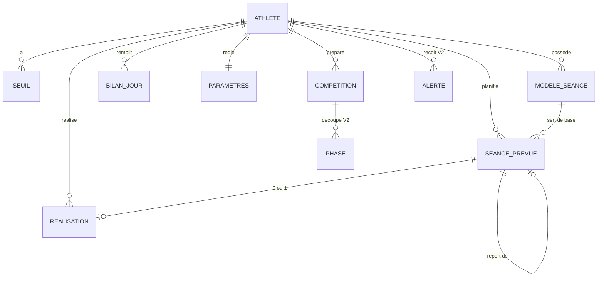
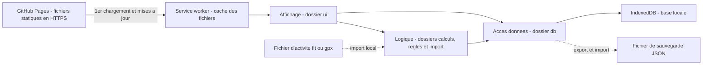
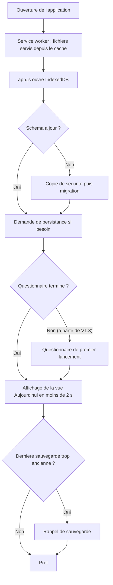
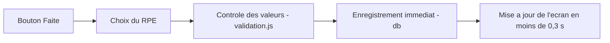
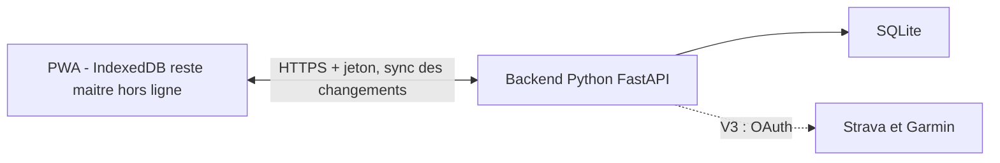
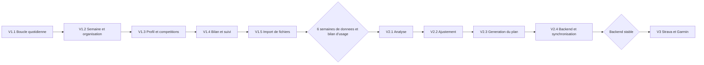
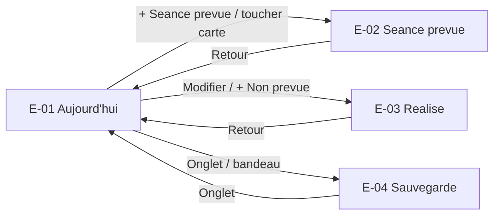

# CLAUDE.md — Application de planification d'entraînement triathlon

> **Ce fichier est la référence du projet.** Il contient le cahier des charges (CDC v1.0), la spécification du lot en cours et les règles de développement.
> Toute modification du périmètre est notée dans le **journal des décisions** (section 10).

---

## 0. Règles pour l'assistant (à lire en premier)

- **Langue** : réponses, commentaires de code et interface en **français**.
- **Code** : modifier **directement les fichiers du projet**. Ne pas recopier les fichiers dans la conversation.
- **Périmètre** : ne coder **que le lot en cours** (section 9). Ne rien ajouter qui ne soit pas dans ce document (pas d'export Excel, de graphique, de fonction « bonus »).
- **Traçabilité** : chaque fonction codée renvoie à son identifiant (F-xx, ENF-xx, C-xx).
- **Simplicité** : HTML/CSS/JS **sans framework**, sans étape de compilation, modules JS natifs (`import` / `export`).
- **Couches** : l'affichage (`ui/`) ne calcule rien ; la logique (`calculs/`, `regles/`) est faite de **fonctions pures** ; seule la couche `db/` accède à IndexedDB.
- **Imports** : avant de modifier un fichier, vérifier les noms réellement exportés par les modules qu'il importe. Une seule erreur d'import rend toute l'application blanche.
- **Encodage** : fichiers en **UTF-8**. Éviter les caractères typographiques spéciaux (tirets longs, guillemets courbes) dans le code et le HTML.
- **Après chaque modification de code** : incrémenter toi-même `VERSION` dans `sw.js` et `VERSION_APP` côté JS.
- **Fin de tâche** : lancer `node --test`, vérifier qu'il n'y a aucune erreur d'import, puis faire un commit git avec un message en français qui cite les identifiants (F-xx, C-xx).

### Environnement de développement
- Poste Windows, dossier : `C:\Users\quent\Desktop\Code\appli_triathlon`
- **Ne jamais ouvrir `index.html` en double-cliquant** (`file://` bloque les modules JS → page blanche).
- Lancer un serveur local depuis le dossier du projet :
  ```powershell
  python -m http.server 8000
  ```
  puis ouvrir **http://localhost:8000** (et non `http://[::]:8000`).
- Pendant le développement : F12 → **Application → Service workers** → cocher « Update on reload », puis recharger avec **Ctrl+F5**.
- En cas de page blanche : F12 → **Console**, lire l'erreur rouge (fichier + ligne).
- Tests automatiques : `node --test`

---

## 1. Objectif du projet

### 1.1 Contexte
Je prépare des triathlons tout en suivant une alternance. Mon emploi du temps varie et mon temps d'entraînement est limité. Je dois gérer trois sports en même temps et doser la charge pour progresser sans me blesser.

### 1.2 Problème
- **Tout est dispersé.** Le plan, les séances réalisées et le ressenti sont notés à des endroits différents, ou pas notés du tout.
- **Le plan ne s'adapte pas.** Quand une séance est manquée ou que la fatigue s'installe, il faut tout réorganiser à la main.
- **On manque de recul.** Il est difficile de voir si la charge et la répartition entre les sports sont équilibrées.

### 1.3 Objectif général
> **Créer une application mobile simple pour planifier, suivre et ajuster mes entraînements de triathlon, afin d'arriver en forme le jour de ma course cible.**

### 1.4 Objectifs spécifiques

| N° | Objectif | Résultat attendu |
|---|---|---|
| O1 | **Planifier** | Je sais chaque jour quelle séance faire, et pourquoi |
| O2 | **Suivre** | Le prévu, le réalisé et le ressenti sont réunis au même endroit |
| O3 | **Ajuster** | Le plan reste réaliste malgré les imprévus et la fatigue |
| O4 | **Analyser** | Je vois chaque semaine ma charge et l'écart entre le prévu et le réalisé |

### 1.5 Utilisateur cible
**Jusqu'à la V3, un seul utilisateur : moi.** Les informations personnelles ne sont pas figées dans ce document : **elles se paramètrent dans l'application** (questionnaire F-42) et restent modifiables.

| Élément | Où il est paramétré |
|---|---|
| Niveau | Profil (F-01) |
| Compétitions (format, date, priorité) | Compétitions (F-07), une ou plusieurs |
| Disponibilités (jours, durées, sports possibles) | Profil (F-04) |
| Matériel (montre, cardio, capteur de puissance, Strava, Garmin) | Profil (F-05) ; la saisie s'adapte (F-43) |
| Usage prévu | Consultation le matin, saisie juste après la séance, sur mobile, parfois sans réseau |

Multi-utilisateur, mode coach et partage : hors planning (6.6).

### 1.6 Périmètre

| Inclus | Exclu |
|---|---|
| Natation, vélo, course à pied, enchaînements, renforcement, repos | Nutrition |
| Planification sur plusieurs semaines | Suivi médical et diagnostic |
| Suivi des séances et du ressenti | Réseau social et classements |
| Ajustement du plan, toujours validé par moi | Paiement et abonnement |
| Import de fichiers d'activité, puis connexion Strava et Garmin | |

### 1.7 Critères de réussite
Détail en **partie 7**. Les trois principaux :
- séance du jour accessible en 1 action (R-02) ;
- séance réalisée saisie en 30 s maximum (R-06) ;
- application toujours utilisée après 8 semaines (R-10).

### 1.8 Contraintes
- **Budget** : 0 €.
- **Développement** : code produit avec Claude Code, qui modifie directement les fichiers du projet ; pas de contrainte de temps ; je teste, déploie et valide chaque lot.
- **Compétences** : principalement Python ; le JS est fourni commenté en français.
- **Données de santé** (FC, sommeil, douleurs, poids) : stockées en local, jamais partagées.

---

## 2. Périmètre fonctionnel

**Légende** — Prio : M = indispensable, S = important, C = bonus. Obj. : objectifs O1 à O4. Lot : découpage de la partie 6.
**Règle** : chaque fonction appartient à un seul lot.

### A. Profil athlète

| ID | Fonction | Obj. | Prio | Lot |
|---|---|---|---|---|
| F-01 | Saisir les infos de base : nom, date de naissance, poids, FC max, FC repos, niveau (débutant, intermédiaire, confirmé) | O1 | M | V1.3 |
| F-02 | Saisir les seuils : CSS (min/100 m), FTP (W), VMA (km/h) ou allure seuil (min/km), FC seuil (bpm) | O1 | M | V1.3 |
| F-03 | Calculer les zones Z1 à Z5 par sport, selon une méthode au choix : % FTP, % FC seuil, % CSS ou VMA, ou RPE | O1 | M | V1.3 |
| F-04 | Saisir les disponibilités : jours possibles, durée max et sports possibles par jour, volume max par semaine | O1 | M | V1.3 |
| F-05 | Saisir les contraintes et le matériel : home trainer, blessure en cours, montre GPS, cardio, capteur de puissance, compte Strava ou Garmin | O1/O3 | S | V1.3 |
| F-06 | Afficher l'historique des seuils, avec la date de chaque test | O4 | S | V2.1 |

**Règles :**
- Seuil inconnu → zones calculées à partir de la FC ; FC inconnue → zones basées sur le RPE.
- Volume prévu d'une semaine supérieur au volume max (F-04) → avertissement dans la vue semaine.

### B. Compétitions

| ID | Fonction | Obj. | Prio | Lot |
|---|---|---|---|---|
| F-07 | Créer une ou plusieurs compétitions : nom, date, format (XS, S, M, 70.3, Ironman), priorité A, B ou C | O1 | M | V1.3 |
| F-08 | Découper la saison en phases à rebours depuis la compétition A : Base, Construction, Spécifique, Affûtage, Récupération | O1 | S | V2.2 |
| F-09 | Prendre en compte les compétitions B (léger allègement avant) et C (aucun changement) | O1 | C | V2.2 |

### C. Planification

| ID | Fonction | Obj. | Prio | Lot |
|---|---|---|---|---|
| F-10 | Créer, modifier et supprimer une séance prévue | O1 | M | V1.1 |
| F-11 | Décrire une séance : sport, type, titre, durée, distance, zone cible, blocs détaillés, marque « séance clé » | O1 | M | V1.1 |
| F-12 | Créer une séance multi-segments (ex. enchaînement vélo puis course) | O1 | S | V1.2 |
| F-13 | Planifier le repos comme une vraie séance | O1 | M | V1.1 |
| F-14 | Afficher le calendrier par semaine | O1 | M | V1.2 |
| F-15 | Déplacer une séance avec un bouton « Déplacer vers… » | O3 | M | V1.2 |
| F-16 | Dupliquer une semaine | O1 | S | V1.2 |
| F-17 | Bibliothèque de séances types : créer une séance à partir d'un modèle en 1 action | O1 | S | V1.2 |
| F-18 | Générer automatiquement un plan à partir des compétitions, des disponibilités et du niveau | O1 | S | V2.3 |
| F-19 | Programmer des séances de test de seuil | O1/O3 | C | V2.2 |
| F-44 | Afficher le calendrier par mois | O1 | C | V2.2 |
| F-45 | Déplacer une séance par glisser-déposer, sur PC | O3 | C | V2.2 |

**Règle :** le cycle charge/récupération (3:1 par défaut, 2:1 possible) sert à F-08 et F-18 ; réglable avec F-41.

### D. Suivi au quotidien (mobile en priorité)

| ID | Fonction | Obj. | Prio | Lot |
|---|---|---|---|---|
| F-20 | Vue « Aujourd'hui » : séances du jour avec contenu et zone cible (valeurs chiffrées des zones une fois le profil rempli) | O1 | M | V1.1 |
| F-21 | Statut de la séance : faite, partielle ou sautée (avec un motif) | O2 | M | V1.1 |
| F-22 | Saisir le réalisé (durée, distance, FC moyenne, puissance), y compris pour une séance non prévue | O2 | M | V1.1 |
| F-23 | Ressenti : RPE de 1 à 10, douleur éventuelle (zone du corps, intensité 1 à 5) | O2 | M | V1.1 |
| F-24 | Commentaire libre | O2 | M | V1.1 |
| F-25 | Bilan du jour, indépendant des séances : sommeil (1-5), fatigue (1-5), poids en option | O2 | S | V1.4 |
| F-43 | Formulaire adapté au matériel : puissance seulement avec capteur, FC seulement avec cardio | O2 | S | V1.3 |

**Critère d'acceptation :** depuis l'ouverture, cocher une séance et noter le RPE prend 3 actions au maximum.

### E. Analyse

| ID | Fonction | Obj. | Prio | Lot |
|---|---|---|---|---|
| F-26 | Comparer volume prévu et réalisé, par sport et par semaine | O4 | M | V1.4 |
| F-27 | Taux d'assiduité par semaine et par sport | O4 | M | V1.4 |
| F-28 | Charge de chaque séance : RPE × durée (min) | O4 | S | V1.4 |
| F-29 | Courbes de forme : CTL (42 j), ATL (7 j), TSB = CTL − ATL | O4 | S | V2.1 |
| F-30 | Alertes à seuils paramétrables | O3/O4 | S | V2.1 |
| F-46 | TSS quand les données de puissance ou d'allure existent | O4 | C | V2.1 |

**Alertes F-30 (défauts, modifiables avec F-41) :** charge hebdo > +10 % ; fatigue ≥ 4/5 pendant 3 jours ; séance clé sautée ; TSB < −30.

### F. Ajustement

| ID | Fonction | Obj. | Prio | Lot |
|---|---|---|---|---|
| F-31 | Séance sautée : proposer de la **reporter** (nouvelle séance liée à l'originale) ou de l'**abandonner** | O3 | M | V1.2 |
| F-32 | Interdire, lors d'un report, deux séances intenses (zone cible ≥ 4) deux jours de suite | O3 | S | V1.2 |
| F-33 | Proposer un allègement sur alerte de fatigue ; rien ne change sans validation | O3 | S | V2.2 |
| F-34 | Proposer la mise à jour des zones après un test de seuil | O3 | C | V2.2 |

### G. Données, import et export

| ID | Fonction | Obj. | Prio | Lot |
|---|---|---|---|---|
| F-35 | Stocker les données en local, disponibles hors ligne | O2 | M | V1.1 |
| F-36 | Exporter et importer une sauvegarde complète (JSON) | O2 | M | V1.1 |
| F-37 | Exporter le plan en Excel ou en PDF | O4 | C | V2.4 |
| F-38 | Importer un fichier .fit ou .gpx, en local et sans serveur | O2 | S | V1.5 |
| F-39 | Se connecter à Strava ou à Garmin | O2 | C | V3 |

**Règles F-38 :** rattachement à la séance prévue du même jour et du même sport (choix manuel si plusieurs) ; sinon séance non prévue ; si une réalisation existe déjà, proposer de la remplacer.

### H. Paramètres et démarrage

| ID | Fonction | Obj. | Prio | Lot |
|---|---|---|---|---|
| F-40 | Régler le thème (auto, clair, sombre) et la fréquence du rappel de sauvegarde | — | S | V1.4 |
| F-41 | Régler les seuils d'alerte et le cycle de charge | O3 | S | V2.1 |
| F-42 | Questionnaire au premier lancement : compétition, disponibilités, matériel, seuils connus (facultatifs) ; peut être passé et repris | O1 | M | V1.3 |

**Bilan :** 46 fonctions — 31 en V1, 14 en V2, 1 en V3.

---

## 3. Exigences non fonctionnelles

### A. Plateforme et compatibilité
| ID | Exigence | Critère de vérification | Version |
|---|---|---|---|
| ENF-01 | PWA installable sur l'écran d'accueil | Installation OK sur Android (Chrome) et iPhone (Safari) | V1 |
| ENF-02 | Mobile d'abord, utilisable sur PC | Affichage correct de 360 à 1920 px, sans défilement horizontal | V1 |
| ENF-03 | Navigateurs récents | 2 dernières versions de Chrome, Edge, Safari, Firefox | V1 |
| ENF-04 | Hébergement statique gratuit en HTTPS | En ligne sur GitHub Pages, 0 € | V1 |

### B. Hors ligne
| ID | Exigence | Critère de vérification | Version |
|---|---|---|---|
| ENF-05 | Toutes les fonctions V1 sans réseau | En mode avion : consultation, saisie, modification, import de fichiers OK | V1 |
| ENF-06 | Synchronisation entre appareils | Séance saisie sur le téléphone visible sur le PC en < 1 min | V2 |

### C. Performance
| ID | Exigence | Critère de vérification | Version |
|---|---|---|---|
| ENF-07 | Ouverture rapide | Vue « Aujourd'hui » en < 2 s | V1 |
| ENF-08 | Réaction immédiate | Retour visuel < 0,3 s après une action | V1 |
| ENF-09 | Plusieurs saisons de données | Pas de ralentissement avec 2 000 séances | V1 |

### D. Ergonomie
| ID | Exigence | Critère de vérification | Version |
|---|---|---|---|
| ENF-10 | Saisie rapide | Cocher + RPE en 3 actions max ; saisie complète ≤ 30 s | V1 |
| ENF-11 | Utilisable d'une main | Zones cliquables ≥ 44 × 44 px ; actions principales en bas | V1 |
| ENF-12 | Lecture visuelle immédiate | Une couleur par sport | V1 |
| ENF-13 | Mode clair et sombre | Suit le téléphone, choix manuel possible (F-40) | V1 |
| ENF-14 | Accessibilité | Contraste ≥ 4,5:1 ; une icône accompagne chaque couleur | V1 |
| ENF-15 | Langue et formats | Français, jj/mm/aaaa, unités métriques, semaine du lundi au dimanche | V1 |

### E. Fiabilité des données
| ID | Exigence | Critère de vérification | Version |
|---|---|---|---|
| ENF-16 | Aucune perte de saisie | Enregistrement automatique, pas de bouton « Enregistrer » | V1 |
| ENF-17 | Sauvegarde régulière | Rappel d'export JSON tous les 7 jours par défaut (réglable, F-40) ; date de dernière sauvegarde visible | V1 |
| ENF-18 | Restauration complète | Après import JSON, données identiques à l'export | V1 |
| ENF-19 | Stockage persistant | Demande au navigateur de ne pas effacer les données | V1 |
| ENF-20 | Saisies contrôlées | Valeurs impossibles refusées avec message : RPE hors 1-10, FC hors 30-230, durée ou distance négative | V1 |

### F. Confidentialité et sécurité
| ID | Exigence | Critère de vérification | Version |
|---|---|---|---|
| ENF-21 | Données de santé sur l'appareil | En V1, aucune requête réseau ne contient de données utilisateur | V1 |
| ENF-22 | Aucun service tiers | Pas de traceur, publicité ni statistiques externes | V1 |
| ENF-23 | Droit à l'effacement (RGPD) | Bouton « Tout supprimer » avec confirmation | V1 |
| ENF-24 | Avertissement à l'export | Message : le fichier JSON contient des données de santé | V1 |
| ENF-25 | Accès protégé à la synchronisation | Authentification par jeton, HTTPS | V2 |

### G. Maintenabilité et évolutivité
| ID | Exigence | Critère de vérification | Version |
|---|---|---|---|
| ENF-26 | Code simple et lisible | HTML/CSS/JS sans framework ; données, logique, affichage séparés ; commentaires en français | V1 |
| ENF-27 | Prêt pour le multi-utilisateur | Chaque enregistrement porte un `athlete_id` | V1 |
| ENF-28 | Évolution du format | `schema_version` + migration automatique précédée d'une copie de sécurité | V1 |
| ENF-29 | Calculs testables | Zones, charge, bilan, validation, report en fonctions pures testées | V1 |
| ENF-30 | Réglages sans toucher au code | Seuils d'alerte et cycle modifiables dans l'appli (F-41) | V2 |

### H. Contraintes du projet
| ID | Contrainte | Valeur |
|---|---|---|
| ENF-31 | Budget | 0 € |
| ENF-32 | Développement | Code produit avec Claude Code, directement dans les fichiers du projet ; pas de contrainte de temps ; tests et validation par moi à chaque lot |
| ENF-33 | Bibliothèques autorisées | Lecture FIT open source (V1.5) et Chart.js (V2), copiées en local |

**Point de vigilance :** Safari (iPhone) peut effacer les données d'un site peu utilisé. Une PWA installée est normalement protégée, mais la sauvegarde JSON (ENF-17) reste la protection principale en V1.

---

## 4. Modèle de données

### 4.1 Conventions
| Élément | Règle |
|---|---|
| Identifiant | `id` UUID, créé par l'application |
| Champs communs | `id`, `athlete_id`, `created_at`, `updated_at` (Meta n'a pas d'`athlete_id`) |
| Suppression | Définitive en V1 ; champ `deleted` à partir de V2.4 |
| Dates | Jour `AAAA-MM-JJ` (heure locale) ; horodatage ISO 8601 UTC ; affichage jj/mm/aaaa |
| Unités stockées | Durée en s, distance en m, puissance en W, FC en bpm, poids en kg |
| Données calculées | Jamais stockées (4.4) |
| Stockage | IndexedDB `triathlon-app`, un store par objet, index sur (`athlete_id`, `date`) |

### 4.2 Vue d'ensemble


### 4.3 Objets

**Meta** (un seul enregistrement, `id` = `meta`)
| Champ | Type | Obligatoire | Réf. |
|---|---|---|---|
| `schema_version` | entier | Oui | ENF-28 |
| `derniere_sauvegarde` | horodatage | Non | ENF-17 |

**Athlete**
| Champ | Type | Obligatoire | Réf. |
|---|---|---|---|
| `nom` | texte | Oui | F-01 |
| `date_naissance` | date | Non | F-01 |
| `poids_kg` | décimal | Non | F-01 |
| `fc_max`, `fc_repos` | entier (bpm) | Non | F-01 |
| `niveau` | DEBUTANT / INTERMEDIAIRE / CONFIRME | Oui | F-01 |
| `disponibilites` | liste de {`jour` 1-7, `duree_max_s`, `sports`} | Oui | F-04 |
| `volume_max_semaine_s` | entier | Oui | F-04 |
| `home_trainer` | booléen | Non | F-05 |
| `blessure_en_cours` | texte | Non | F-05 |
| `materiel` | {`montre_gps`, `cardio`, `capteur_puissance`, `strava`, `garmin`} booléens | Oui (faux par défaut) | F-05, F-43 |
| `questionnaire_termine` | booléen | Oui | F-42 |

**Seuil**
| Champ | Type | Obligatoire | Réf. |
|---|---|---|---|
| `type` | CSS / FTP / VMA / ALLURE_SEUIL / FC_SEUIL | Oui | F-02 |
| `valeur` | décimal | Oui | F-02 |
| `date` | date | Oui | F-02, F-06 |
| `source` | TEST / ESTIMATION | Oui | F-19 |

Unités : CSS en s/100 m, FTP en W, VMA en km/h, allure seuil en s/km, FC seuil en bpm. **Seuil actif = le plus récent par type.**

**Competition**
| Champ | Type | Obligatoire | Réf. |
|---|---|---|---|
| `nom` | texte | Oui | F-07 |
| `date` | date | Oui | F-07 |
| `format` | XS / S / M / 70.3 / IRONMAN | Oui | F-07 |
| `priorite` | A / B / C | Oui | F-07 |

**SeancePrevue**
| Champ | Type | Obligatoire | Réf. |
|---|---|---|---|
| `date` | date | Oui | F-10 |
| `ordre` | entier | Oui | F-20 |
| `sport` | NATATION / VELO / CAP / ENCHAINEMENT / RENFO / REPOS | Oui | F-11, F-13 |
| `type` | ENDURANCE / SEUIL / FRACTIONNE / TECHNIQUE / TEST / RECUP | Oui | F-11 |
| `titre` | texte (60 car. max) | Oui | F-11 |
| `duree_s`, `distance_m` | entier | Non | F-11 |
| `zone_cible` | 1 à 5 | Non | F-11, F-32 |
| `cle` | booléen | Oui (faux) | F-11, F-30 |
| `segments` | liste de Segment | Non | F-12 |
| `description` | texte | Non | F-11 |
| `modele_id` | id | Non | F-17 |
| `report_de` | id de la séance sautée d'origine | Non | F-31 |

**Segment** (intégré à la séance)
| Champ | Type | Réf. |
|---|---|---|
| `ordre` | entier | F-12 |
| `sport` | NATATION / VELO / CAP / RENFO | F-12 |
| `blocs` | liste de {`repetitions`, `duree_s` ou `distance_m`, `zone`, `recup_s`} | F-11 |

**ModeleSeance** : mêmes champs que SeancePrevue, sans `date`, `ordre`, `modele_id`, `report_de` (F-17).

**Realisation**
| Champ | Type | Obligatoire | Réf. |
|---|---|---|---|
| `seance_prevue_id` | id ; vide si non prévue | Non | F-21, F-22 |
| `date` | date | Oui | F-21 |
| `sport` | comme SeancePrevue | Oui | F-22 |
| `statut` | FAITE / PARTIELLE / SAUTEE | Oui | F-21 |
| `motif` | FATIGUE / BLESSURE / TEMPS / METEO / AUTRE | Si SAUTEE | F-21 |
| `suite` | REPORTEE / ABANDONNEE | Si SAUTEE (à partir de V1.2) | F-31 |
| `duree_s`, `distance_m` | entier | `duree_s` si FAITE ou PARTIELLE | F-22 |
| `fc_moy` | entier (bpm) | Non | F-22 |
| `puissance_moy_w` | entier | Non | F-22 |
| `rpe` | 1 à 10 | Si FAITE ou PARTIELLE | F-23 |
| `douleur` | {`zone`, `intensite` 1-5} | Non | F-23 |
| `commentaire` | texte | Non | F-24 |
| `source` | MANUEL / FICHIER / STRAVA / GARMIN | Oui (MANUEL) | F-38, F-39 |

**BilanJour**
| Champ | Type | Obligatoire | Réf. |
|---|---|---|---|
| `date` | date | Oui | F-25 |
| `sommeil`, `fatigue` | 1 à 5 | Non | F-25 |
| `poids_kg` | décimal | Non | F-25 |
| `commentaire` | texte | Non | F-25 |

**Parametres** (un par athlète)
| Champ | Type | Défaut | Version | Réf. |
|---|---|---|---|---|
| `theme` | AUTO / CLAIR / SOMBRE | AUTO | V1 | F-40 |
| `rappel_sauvegarde_jours` | entier | 7 | V1 | F-40, ENF-17 |
| `methode_zones` | par sport : FTP / FC / CSS / VMA / RPE | selon seuils et matériel | V1.3 | F-03 |
| `cycle` | {`charge`, `recup`} semaines | 3:1 | V2 | F-41 |
| `seuils_alertes` | {`hausse_charge_pct`, `fatigue_min`, `fatigue_jours`, `tsb_min`} | 10, 4, 3, −30 | V2 | F-41 |

**Phase** (V2) : `competition_id`, `type` (BASE / CONSTRUCTION / SPECIFIQUE / AFFUTAGE / RECUPERATION), `date_debut`, `date_fin` (F-08).

**Alerte** (V2) : `type` (HAUSSE_CHARGE / FATIGUE / SEANCE_CLE_SAUTEE / TSB_BAS), `date`, `message`, `statut` (NOUVELLE / ACCEPTEE / IGNOREE), `proposition` (appliquée seulement après validation) (F-30, F-33).

### 4.4 Données calculées (jamais stockées)
| Donnée | Calcul | Réf. | Version |
|---|---|---|---|
| Zones | Seuil actif + `methode_zones` | F-03 | V1 |
| Allure | CAP : min/km ; natation : min/100 m ; vélo : km/h | F-22 | V1 |
| Durée d'une séance à segments | Somme des segments | F-12 | V1 |
| Charge | RPE × durée (min) ; 0 pour le repos | F-28 | V1 |
| Volume prévu / réalisé | Somme des durées par sport et par semaine (lundi-dimanche) | F-26 | V1 |
| Assiduité | Séances FAITE / séances prévues hors REPOS ; une séance reportée ne compte qu'une fois (nouvelle date) | F-27 | V1 |
| TSS | Puissance ou allure + seuils | F-46 | V2 |
| CTL / ATL / TSB | Moyennes pondérées exponentielles 42 j et 7 j ; TSB = CTL − ATL | F-29 | V2 |

La semaine n'est pas un objet : elle se déduit de la date.

### 4.5 Règles d'intégrité
1. Une séance prévue a au maximum une réalisation.
2. Une réalisation SAUTEE n'a pas de mesures (seuls motif, suite, commentaire).
3. Reporter crée une nouvelle SeancePrevue avec `report_de` ; l'originale garde sa réalisation SAUTEE avec `suite` = REPORTEE.
4. Un seul BilanJour par athlète et par date.
5. Supprimer une séance prévue réalisée conserve la réalisation (`seance_prevue_id` vidé).
6. Valeurs contrôlées à la saisie (ENF-20).
7. Chaque changement de format incrémente `schema_version` et déclenche une migration.

---

## 5. Architecture

### 5.1 Choix de la technologie
| Option | Hors ligne mobile | Coût | Verdict |
|---|---|---|---|
| **PWA HTML/CSS/JS** | Oui | 0 € | **Retenue** |
| Web Python (Streamlit, Flask, Django) | Non (serveur actif) | Hébergement | Écartée (ENF-05) |
| Python natif (Kivy, BeeWare) | Oui | iPhone : Mac requis | Écartée |
| PyScript | Oui | 0 € | Écartée : démarrage lent (ENF-07) |
| Natif (Kotlin, Swift) | Oui | Compte payant iPhone | Écartée |
| Excel | Partiel | 0 € | Écartée (ENF-10) |

**Décision :** application en **JS** ; **Python** pour le backend à partir de V2.4.

### 5.2 Vue d'ensemble V1


### 5.3 Couches
| Couche | Rôle | Règle |
|---|---|---|
| Affichage (`ui/`) | Écrans, formulaires, navigation | Aucun calcul métier |
| Logique (`calculs/`, `regles/`, `import/`) | Zones, charge, bilan, contrôles, report, lecture .fit/.gpx | Fonctions pures (ENF-29) |
| Données (`db/`) | IndexedDB, migrations, sauvegarde | Seule couche qui accède à IndexedDB |

### 5.4 Arborescence
```text
triathlon-app/
├── CLAUDE.md               # Ce fichier
├── index.html              # Point d'entrée unique (<main id="app">)
├── manifest.json           # Installation (ENF-01)
├── sw.js                   # Service worker, VERSION à changer à chaque mise en ligne
├── package.json            # Uniquement pour node --test
├── creer_icones.py         # Génère icons/icon-192.png et icon-512.png
├── css/style.css           # Thèmes, couleurs par sport
├── icons/                  # icon-192.png, icon-512.png
├── js/
│   ├── app.js              # Démarrage + routeur (#/aujourdhui, #/seance/…)
│   ├── db/
│   │   ├── database.js     # IndexedDB, CRUD (F-35)
│   │   ├── migrations.js   # schema_version, premier lancement (ENF-28, C-01)
│   │   └── sauvegarde.js   # Export / import JSON (F-36)
│   ├── calculs/            # zones.js (V1.3), charge.js, bilan.js (V1.4)
│   ├── regles/
│   │   ├── validation.js   # Contrôles et conversions (ENF-20)
│   │   └── report.js       # V1.2 (F-31, F-32)
│   ├── import/             # gpx.js, fit.js (V1.5)
│   └── ui/
│       ├── commun.js       # Constantes (sports, zones, messages) + outils d'affichage
│       ├── aujourdhui.js   # E-01 (F-20, F-21, F-23)
│       ├── seance.js       # E-02 (F-10, F-11, F-13)
│       ├── realisation.js  # E-03 (F-21 à F-24)
│       └── sauvegarde.js   # E-04 (F-36, ENF-23, ENF-24)
├── lib/                    # Bibliothèques copiées en local (V1.5, V2)
└── tests/                  # node --test
```

### 5.5 Composants techniques
| Composant | Solution | Réf. |
|---|---|---|
| Installation | `manifest.json` (nom, icônes 192 et 512, `display: standalone`) | ENF-01 |
| Hors ligne | Service worker, stratégie « cache d'abord » | ENF-05 |
| Navigation | Routeur par ancre, sans rechargement | ENF-07 |
| Stockage | IndexedDB via `db/database.js`, sans bibliothèque | F-35 |
| Persistance | `navigator.storage.persist()` au premier lancement | ENF-19 |
| Migrations | Comparaison de `schema_version` ; copie de sécurité puis migration | ENF-28 |
| Sauvegarde | Export `.json` ; import avec contrôle du format avant écriture | F-36, ENF-18 |
| Import d'activité | GPX via parseur XML du navigateur ; FIT via bibliothèque locale | F-38 |
| Graphiques | Barres HTML/CSS en V1 ; Chart.js local en V2 | F-26, F-29 |
| Sécurité | CSP interdisant tout script et appel externe | ENF-21, ENF-22 |

### 5.6 Flux principaux

**Démarrage**


**Saisie d'une séance réalisée**


**Mise à jour de l'application**


### 5.7 Tests et déploiement
| Élément | Solution |
|---|---|
| Tests automatiques | `node --test` sur `calculs/` et `regles/` |
| Tests manuels | Liste à cocher du lot (mode avion, installation Android/iPhone, export puis import, migration) |
| Développement local | `python -m http.server 8000` → http://localhost:8000 |
| Gestion du code | Git + dépôt GitHub |
| Mise en ligne | GitHub Pages, branche `main` |
| Versions | `VERSION` de `sw.js` = version affichée dans l'appli |

### 5.8 Évolution V2 et V3


| Point | Décision | Réf. |
|---|---|---|
| Backend | Python FastAPI, à partir de V2.4 | V2.4 |
| Base | SQLite (PostgreSQL seulement si mode coach) | V2.4 |
| Synchronisation | Objets modifiés depuis la dernière sync (`updated_at`) ; conflit : la plus récente l'emporte ; suppressions via `deleted` | ENF-06 |
| Authentification | Jeton, HTTPS | ENF-25 |
| Calculs | Restent en JS dans l'appli | F-28, F-29 |
| Export Excel/PDF | Généré par le backend Python | F-37 |
| Fichiers .fit/.gpx | V1.5, en local | F-38 |
| Strava, Garmin | V3, via le backend (clé OAuth côté serveur) | F-39 |

### 5.9 Risques techniques
| Risque | Impact | Parade |
|---|---|---|
| Effacement des données par Safari | Perte de l'historique | Installation, `persist()`, rappel de sauvegarde |
| Ancienne version bloquée dans le cache | Corrections non reçues | `VERSION` dans `sw.js` + bandeau de mise à jour |
| Page blanche au lancement | Appli inutilisable | Erreur d'import ou de syntaxe dans un module → lire la console F12 |
| Migration ratée | Données corrompues | Copie de sécurité automatique |
| Fichier .fit mal lu | Mesures fausses | Aperçu avant validation de l'import |
| API Garmin non garantie | V3 incomplète | Import de fichier (V1.5) toujours disponible |
| Conflits de synchronisation | Doublons | UUID + règle « la plus récente l'emporte » |

---

## 6. Découpage en versions

### 6.1 Principes
- Chaque lot livre une application utilisable.
- Dans un lot : M, puis S, puis C.
- Passage V1 → V2 uniquement après usage réel et bilan d'usage.
- Chaque fonction appartient à un seul lot.

### 6.2 Vue d'ensemble


### 6.3 V1 : application locale (31 fonctions)
| Lot | But | Fonctions | Exigences clés |
|---|---|---|---|
| **V1.1 Boucle quotidienne** | Saisir et cocher mes séances | F-10, F-11, F-13, F-20 à F-24, F-35, F-36 (+ ENF-23 avancée) | ENF-01, 05, 10, 16 à 21, 23, 24 |
| **V1.2 Semaine et organisation** | Voir et réorganiser ma semaine | F-12, F-14, F-15, F-16, F-17, F-31, F-32 | ENF-08, 11, 12 |
| **V1.3 Profil et compétitions** | Profil, zones, matériel, courses | F-01 à F-05, F-07, F-42, F-43 | ENF-20, 29 |
| **V1.4 Bilan et suivi** | Prévu / réalisé / charge par semaine | F-25 à F-28, F-40 | ENF-13, 14, 15 |
| **V1.5 Import de fichiers** | Remplir le réalisé depuis la montre | F-38 | ENF-33 |

**V1 terminée quand :** 31 fonctions et 27 exigences V1 vérifiées ; tests manuels OK sur Android et iPhone ; tests automatiques OK.
**Passage en V2 quand :** ≥ 6 semaines de données ; V1 complète utilisée ≥ 4 semaines ; bilan d'usage fait ; R-11 et R-12 atteints.

### 6.4 V2 (14 fonctions)
| Lot | But | Fonctions |
|---|---|---|
| **V2.1 Analyse** | Forme et alertes | F-06, F-29, F-30, F-41, F-46 |
| **V2.2 Ajustement et planif. avancée** | Plan qui s'adapte, avec validation | F-08, F-09, F-19, F-33, F-34, F-44, F-45 |
| **V2.3 Génération automatique** | Plan proposé | F-18 |
| **V2.4 Backend et synchronisation** | Téléphone + PC, exports | F-37 + backend FastAPI/SQLite |

V2.1 à V2.3 restent 100 % locaux.

### 6.5 V3 (1 fonction)
| Lot | But | Fonction | Prérequis |
|---|---|---|---|
| **V3** | Récupération automatique des activités | F-39 | Backend V2.4 stable |

### 6.6 Hors planning
Plusieurs athlètes, mode coach, partage d'un plan (le modèle le permet via `athlete_id`).

### 6.7 Récapitulatif
| Version | Fonctions | Backend | Condition de démarrage |
|---|---|---|---|
| V1 | 31 | Non | CDC validé |
| V2 | 14 | V2.4 seulement | 6 semaines de données, 4 semaines d'usage, bilan |
| V3 | 1 | Oui | Backend stable |
| **Total** | **46** | | |

---

## 7. Critères de réussite et validation

### 7.1 Deux niveaux
| Niveau | Question | Où |
|---|---|---|
| Recette | L'appli fait-elle ce qui est demandé ? | Parties 2, 3, 6 |
| Réussite | Atteint-elle ses objectifs en usage réel ? | Cette partie |

Les critères évaluent **l'outil**, pas mes performances sportives.

### 7.2 Critères V1
| ID | Obj. | Indicateur | Seuil | Mesure |
|---|---|---|---|---|
| R-01 | O1 | Semaines dont le plan est saisi avant le lundi | ≥ 90 % | `created_at` des SeancePrevue |
| R-02 | O1 | Accès séance du jour / plan de la semaine | 1 / 2 actions | Test manuel |
| R-03 | O2 | Séances prévues avec un statut | ≥ 95 % | Réalisations / prévues hors REPOS |
| R-04 | O2 | Séances saisies le jour même | ≥ 80 % | `created_at` = `date` |
| R-05 | O2 | Séances faites ou partielles avec RPE | ≥ 90 % | `rpe` renseigné |
| R-06 | O2 | Durée de saisie | ≤ 30 s | Chronométré sur 5 saisies |
| R-07 | O3 | Séances sautées traitées sous 48 h | ≥ 90 % | `suite` renseignée < 48 h |
| R-08 | O3 | Reports créant deux Z4+ de suite | 0 | Historique |
| R-09 | O4 | Semaines où le bilan est consulté | ≥ 80 % | Bilan d'usage |
| R-10 | Adoption | Jours avec séance où l'appli est utilisée, semaines 7-8 | ≥ 80 % | Saisies présentes |
| R-11 | Fiabilité | Données perdues | 0 | Comparaison avec la sauvegarde |
| R-12 | Fiabilité | Restauration d'une vraie sauvegarde | Réussie | Export → effacement → import |
| R-13 | Satisfaction | Remplace le papier / Excel | Oui | Bilan d'usage |
| R-14 | Satisfaction | Note globale | ≥ 4/5 | Bilan d'usage |

### 7.3 Moments de mesure
| Moment | Critères | Décision |
|---|---|---|
| Fin V1.1 + 2 semaines | R-03 à R-06, R-11 | Continuer V1.2 ou simplifier la saisie |
| 8 semaines après V1.1 | R-10, R-13, R-14 | Confirmer l'adoption |
| Fin V1 + 4 semaines | R-01 à R-14 | Passer en V2 ou corriger |

### 7.4 En cas d'échec
| Critère | Cause probable | Action |
|---|---|---|
| R-03, R-04, R-06 | Saisie trop lourde | Moins de champs obligatoires, plus de valeurs par défaut |
| R-01 | Planification trop longue | Modèles (F-17), duplication (F-16) |
| R-07 | Report mal placé | Proposer le report juste après « sautée » |
| R-09 | Bilan peu utile | Revoir son contenu avant la V2 |
| R-10, R-13 | Non adoptée | Bilan détaillé avant tout développement |
| R-11, R-12 | Fiabilité | **Bloquant** : correction immédiate |

**Règle :** pas de V2 tant que R-11 et R-12 ne sont pas atteints, ni avec plus de 3 critères en échec.

### 7.5 Critères V1.5, V2, V3
| ID | Lot | Indicateur | Seuil |
|---|---|---|---|
| R-15 | V2.1 | Alertes ignorées | < 50 % |
| R-16 | V2.2 | Allègements acceptés | ≥ 50 % |
| R-17 | V2.3 | Séances générées conservées sans modification | ≥ 70 % |
| R-18 | V2.4 | Conflits de sync avec perte | 0 |
| R-19 | V1.5, V3 | Activités importées rattachées à la bonne séance | ≥ 90 % |

### 7.6 Bilan d'usage (10 min)
1. Fonctions jamais utilisées ?
2. Écran le plus pénible ?
3. Ce que je note encore ailleurs ?
4. Fonction qui m'a manqué ?
5. Note sur 5 (R-14) ; remplace papier/Excel : oui/non (R-13).
6. Bilan consulté chaque semaine (R-09) ?

---

## 8. Glossaire
| Terme | Définition |
|---|---|
| CSS | Allure seuil en natation (temps au 100 m) |
| FTP | Puissance seuil à vélo, tenable environ 1 h (W) |
| VMA | Vitesse maximale aérobie (km/h) |
| RPE | Effort perçu, de 1 (très facile) à 10 (maximal) |
| Charge | RPE × durée en minutes |
| CTL / ATL / TSB | Forme de fond (42 j) / fatigue récente (7 j) / fraîcheur |
| TSS | Score de charge à partir de la puissance ou de l'allure |
| PWA | Application web installable, fonctionne hors ligne |
| Service worker | Script qui met l'application en cache |
| Enchaînement (brick) | Vélo suivi directement de course à pied |

---

## 9. Spécification du lot en cours : V1.1 « Boucle quotidienne »

**Fonctions :** F-10, F-11, F-13, F-20 à F-24, F-35, F-36 + ENF-23 (avancée, D-03).
**Hors V1.1, à ne pas coder :** profil, zones chiffrées, vue semaine, modèles, report, bilan, paramètres, import de fichiers.

### 9.1 Écrans
| ID | Écran | Route | Contenu |
|---|---|---|---|
| E-01 | Aujourd'hui | `#/aujourdhui?date=AAAA-MM-JJ` | En-tête « ◀ Mardi 27/10/2026 ▶ », lien « Aujourd'hui » si autre jour ; cartes des séances par `ordre` ; séances non prévues ; boutons « + Séance prévue » et « + Séance non prévue » en bas |
| E-02 | Formulaire séance prévue | `#/seance/nouvelle?date=…`, `#/seance/{id}` | Champs 9.4.1 ; « Supprimer » (en modification) ; « Retour » |
| E-03 | Détails du réalisé | `#/realisation/{id}`, `#/realisation/nouvelle?date=…` | Champs 9.4.2 ; « Effacer le statut » |
| E-04 | Sauvegarde | `#/sauvegarde` | Date de dernière sauvegarde ; « Exporter », « Importer », « Tout supprimer » |

**Carte de séance (E-01) :** icône + couleur du sport, titre, badge « ★ Clé » ; durée, distance, zone + repère RPE ; blocs repliables (« 5 × 400 m Z4, récup 1:00 ») ; sans statut → boutons **Faite / Partielle / Sautée** (pas pour le repos) ; avec statut → badge + lien « Modifier ». Toucher la carte (hors boutons) ouvre E-02.

**Barre d'onglets (bas, fixe) :** Aujourd'hui | Sauvegarde.

### 9.2 Comportements
| ID | Situation | Action | Résultat attendu |
|---|---|---|---|
| C-01 | Premier lancement | Ouverture | Création Meta (`schema_version` = 1), athlète par défaut, paramètres par défaut ; `persist()` ; affichage E-01 |
| C-02 | Aucune séance | E-01 | « Aucune séance prévue. » + boutons d'ajout |
| C-03 | E-01 | « + Séance prévue » | E-02 avec la date affichée ; `ordre` = dernier + 1 |
| C-04 | E-02 | Modification d'un champ | Enregistrement auto 0,5 s après la dernière frappe ou à la sortie du champ ; rien n'est créé tant que le titre est vide |
| C-05 | E-02, sport REPOS | Choix | Type, durée, distance, zone, blocs masqués ; `type` = RECUP |
| C-06 | Carte sans statut | **Faite** | Feuille RPE (10 boutons avec libellés) |
| C-07 | Feuille RPE | Choix d'une note | Réalisation FAITE créée (durée et distance prévues reprises) ; **2 actions** |
| C-08 | C-06 sans durée prévue | — | Champ « Durée (h:mm) » obligatoire + bouton « Valider » (3 actions) |
| C-09 | Carte sans statut | **Partielle** | RPE + durée réalisée obligatoire, préremplie |
| C-10 | Carte sans statut | **Sautée** | 5 boutons de motif ; un toucher crée la réalisation SAUTEE |
| C-11 | Carte avec statut | « Modifier » | E-03 : statut, mesures, douleur, commentaire ; « Effacer le statut » supprime la réalisation après confirmation |
| C-12 | E-01 | « + Séance non prévue » | E-03 sans `seance_prevue_id` ; sport, durée, RPE obligatoires ; statut FAITE |
| C-13 | E-02 | « Supprimer » | Confirmation M-03 ; réalisation conservée, `seance_prevue_id` vidé |
| C-14 | E-02 / E-03 | Valeur invalide | Champ en rouge + message ; rien n'est enregistré |
| C-15 | Démarrage | Pas de sauvegarde depuis > 7 jours (ou jamais) et des données existent | Bandeau M-05 en haut de E-01 → E-04 |
| C-16 | E-04 | « Exporter » | Avertissement M-06 → `triathlon-sauvegarde-AAAA-MM-JJ.json` ; mise à jour de `derniere_sauvegarde` |
| C-17 | E-04 | « Importer » | Contrôle du format (9.6) ; invalide → M-08 ; valide → confirmation M-07, remplacement, retour E-01 |
| C-18 | E-04 | « Tout supprimer » | Saisie de SUPPRIMER (M-09) → base vidée → état C-01 |
| C-19 | E-01 | ◀ / ▶ | Jour précédent / suivant en < 0,3 s |

### 9.3 Navigation


### 9.4 Valeurs exactes

#### 9.4.1 Formulaire séance prévue (E-02)
| Champ | Contrôle | Valeurs / format | Défaut | Obligatoire |
|---|---|---|---|---|
| Date | sélecteur | jj/mm/aaaa | jour affiché | Oui |
| Sport | boutons | Natation, Vélo, Course, Renfo, Repos | Course | Oui |
| Type | liste | Endurance, Seuil, Fractionné, Technique, Test, Récup | Endurance | Oui (sauf Repos) |
| Titre | texte, 60 car. | — | vide | Oui |
| Durée | h:mm (accepte aussi 1h30, 1.30, ou minutes seules) | 0:01 à 12:00 | vide | Non |
| Distance | décimal, km (m pour la natation) | > 0 | vide | Non |
| Zone cible | boutons | Aucune, Z1 à Z5 | aucune | Non |
| Séance clé | case | oui / non | non | Oui |
| Blocs | répétitions, durée (m:ss) **ou** distance (m), zone, récup (m:ss) | « + Ajouter un bloc » | aucun | Non |
| Description | texte multiligne | — | vide | Non |

#### 9.4.2 Détails du réalisé (E-03)
| Champ | Valeurs | Obligatoire |
|---|---|---|
| Statut | Faite / Partielle / Sautée | Oui |
| Motif (si Sautée) | Fatigue, Blessure, Manque de temps, Météo, Autre | Oui |
| Durée | h:mm | Si Faite ou Partielle |
| Distance | km (m pour la natation) | Non |
| FC moyenne | bpm | Non |
| Puissance moyenne | W, vélo uniquement | Non |
| RPE | 1 à 10 | Si Faite ou Partielle |
| Douleur | Pied, Cheville, Mollet, Genou, Cuisse, Hanche, Dos, Épaule, Autre + intensité 1-5 | Non |
| Commentaire | texte | Non |

L'allure est affichée sous les champs (calculée, non stockée).

#### 9.4.3 Sports et zones
| Sport | Code | Couleur | Icône |
|---|---|---|---|
| Natation | NATATION | #1565C0 | 🏊 |
| Vélo | VELO | #E65100 | 🚴 |
| Course | CAP | #2E7D32 | 🏃 |
| Renfo | RENFO | #6A1B9A | 💪 |
| Repos | REPOS | #616161 | 😴 |
| Enchaînement (V1.2) | ENCHAINEMENT | #C62828 | 🔁 |

| Zone | RPE | Libellé |
|---|---|---|
| Z1 | 1-2 | Très facile, récupération |
| Z2 | 3-4 | Endurance, conversation possible |
| Z3 | 5-6 | Tempo, phrases courtes |
| Z4 | 7-8 | Seuil, quelques mots |
| Z5 | 9-10 | Maximal |

**Libellés RPE :** 1-2 Très facile · 3-4 Facile · 5-6 Modéré · 7-8 Difficile · 9 Très difficile · 10 Maximal.

#### 9.4.4 Messages
| ID | Texte |
|---|---|
| M-01 | « Le titre est obligatoire. » |
| M-02 | « Valeur impossible : {champ} doit être entre {min} et {max}. » |
| M-03 | « Supprimer cette séance ? Le réalisé éventuel sera conservé. » |
| M-04 | « Effacer le statut de cette séance ? » |
| M-05 | « Dernière sauvegarde : {il y a X jours / jamais}. Sauvegarder maintenant ? » |
| M-06 | « Ce fichier contient des données de santé (FC, douleurs). Garde-le dans un endroit privé. » |
| M-07 | « L'import remplace toutes les données actuelles. Continuer ? » |
| M-08 | « Fichier invalide : ce n'est pas une sauvegarde de l'application. » |
| M-09 | « Toutes les données seront effacées définitivement. Tape SUPPRIMER pour confirmer. » |
| M-10 | « Champ obligatoire. » |

**Bornes (ENF-20) :** RPE 1-10 · FC 30-230 bpm · puissance 0-2 000 W · durée 1 min-12 h · distance > 0 et ≤ 300 km · répétitions 1-50.

### 9.5 Données du lot
| Objet | Usage | Remarques |
|---|---|---|
| Meta | Lecture / écriture | `schema_version` = 1 |
| Athlete | Création par défaut | `nom` = « Athlète », `niveau` = DEBUTANT, matériel à faux, `questionnaire_termine` = faux |
| Parametres | Création par défaut | `theme` = AUTO, `rappel_sauvegarde_jours` = 7 |
| SeancePrevue | CRUD | Un seul segment (D-05), vide pour le repos |
| Realisation | CRUD | `source` = MANUEL ; pas de `suite` en V1.1 |

Stores : `meta`, `athletes`, `parametres`, `seances_prevues`, `realisations`. Index : `athlete_date` (séances et réalisations), `seance_prevue_id` (réalisations).

### 9.6 Format de sauvegarde
```json
{
  "app": "triathlon-app",
  "schema_version": 1,
  "date_export": "2026-10-27T08:00:00Z",
  "donnees": {
    "meta": [], "athletes": [], "parametres": [],
    "seances_prevues": [], "realisations": []
  }
}
```
Import accepté seulement si `app` = « triathlon-app », `schema_version` ≤ version du code et les 5 tableaux présents.

### 9.7 Tests d'acceptation V1.1

**Automatiques (`node --test`)**
- [ ] Bornes de 9.4.4, valeurs limites incluses
- [ ] Conversion h:mm ↔ secondes dans les deux sens (dont « 1:15 »)
- [ ] Allure correcte par sport
- [ ] Rejet des fichiers de sauvegarde incorrects

**Manuels (Android et iPhone)**
| Réf. | Test | OK |
|---|---|---|
| F-10 | Créer, modifier, supprimer une séance ; réalisation conservée (C-13) | ☐ |
| F-11 | Séance avec 2 blocs et « clé » bien affichée | ☐ |
| F-13 | Repos masque les champs inutiles | ☐ |
| F-20 | Séances du jour dans l'ordre ; ◀ ▶ fonctionnent | ☐ |
| F-21 | Faite, Partielle, Sautée (motif) ; effacement du statut | ☐ |
| F-22 | Réalisé saisi ; séance non prévue ; allure juste | ☐ |
| F-23 / F-24 | RPE, douleur, commentaire enregistrés | ☐ |
| F-35 / ENF-05 | Tout fonctionne en mode avion | ☐ |
| F-36 / ENF-18 | Export → Tout supprimer → Import : données identiques | ☐ |
| ENF-01 | Installation sur l'écran d'accueil (icônes 192 et 512 présentes) | ☐ |
| ENF-07 / 08 | Ouverture < 2 s, réaction < 0,3 s | ☐ |
| ENF-10 | Faite + RPE en 2 actions ; saisie complète < 30 s | ☐ |
| ENF-11 / 12 / 14 | Boutons ≥ 44 px, couleur + icône par sport | ☐ |
| ENF-16 | Pas de bouton « Enregistrer » ; données conservées après fermeture brutale | ☐ |
| ENF-17 | Bandeau de rappel après 7 jours | ☐ |
| ENF-19 | `persist()` appelé (console) | ☐ |
| ENF-20 | Valeurs hors bornes refusées avec message | ☐ |
| ENF-21 / 22 | Aucune requête réseau sortante | ☐ |
| ENF-23 / 24 | « Tout supprimer » exige SUPPRIMER ; avertissement à l'export | ☐ |

---

## 10. Journal des décisions

| N° | Date | Décision |
|---|---|---|
| — | 10/2026 | CDC v1.0 figé |
| D-01 | 10/2026 | Au premier lancement, création d'un athlète par défaut, complété par F-42 en V1.3 |
| D-02 | 10/2026 | Sans seuils, la zone s'affiche avec un repère RPE |
| D-03 | 10/2026 | « Tout supprimer » (ENF-23) placé dans l'écran Sauvegarde dès V1.1 |
| D-04 | 10/2026 | En V1.1, navigation jour par jour (◀ ▶) ; la vue semaine arrive en V1.2 |
| D-05 | 10/2026 | Sport ENCHAINEMENT masqué jusqu'en V1.2 ; une séance = un seul segment en V1.1 |
| D-06 | 10/2026 | Pas de champ `suite` en V1.1 (report en V1.2) |
| D-07 | 10/2026 | Fichiers ajoutés : `ui/realisation.js` (E-03), `ui/commun.js` (constantes + outils), `package.json`, `creer_icones.py` |
| D-08 | 10/2026 | Message M-10 « Champ obligatoire. » ajouté |
| D-09 | 10/2026 | Saisie de durée souple : « 1:30 », « 1h30 », « 1.30 » ou minutes seules (« 90 ») |
| D-10 | 10/2026 | Pas de boutons Faite / Partielle / Sautée sur une carte Repos |
| D-11 | 10/2026 | Développement local obligatoirement via `python -m http.server` (pas de `file://`) |
| D-12 | 11/2026 | Passage à Claude Code : fichiers modifiés directement, `VERSION` incrémentée par l'assistant, `node --test` + commit git en fin de tâche ; projet déplacé dans `C:\Users\quent\Desktop\Code\appli_triathlon` |
| D-13 | 11/2026 | Projet démarré de zéro sur un nouveau poste |

---

## 11. État d'avancement

| Lot | Statut |
|---|---|
| V1.1 | À démarrer : aucun code écrit |
| V1.2 à V1.5 | À faire |
| V2, V3 | Non démarrés |

**Prochaine étape :** développer le lot V1.1 complet.
